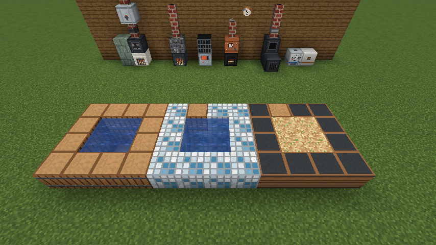
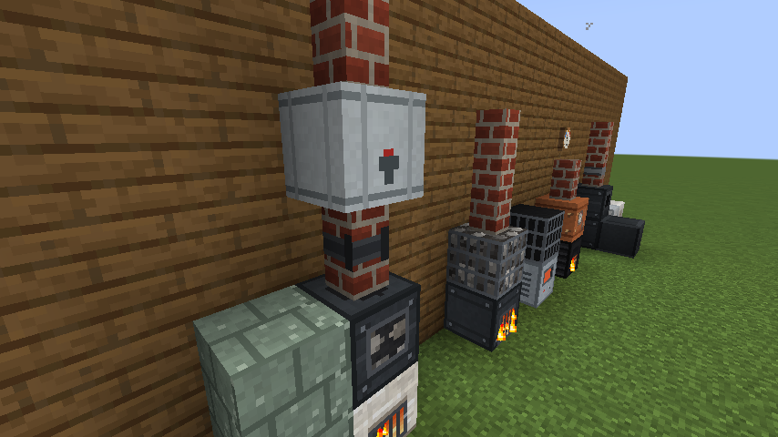

# Bathhouse — мод про бани (NeoForge 1.21.1)



Три типа бань, которые **собираются из факторов**: температура, влажность, дым, отделка стен и
**мультиблочные печи** из отдельных частей. Каждая баня даёт долгий эффект — 40 минут, как
«Герой деревни». Эффект разделён на 3 части, которые выдаются по **уровню парения** (1–3).
Также есть мультиблочные **купели**: студёная, горячая и опилочная.

| Тип (в игре) | Прообраз | Климат | Стены | Нужна печь | Топка | Эффекты: ур. 1 → 2 → 3 |
|---|---|---|---|---|---|---|
| **Туманница** | хаммам | 35–50 °C, 90–100 % | камень ≥ 50 % | парогенератор или печь с котлом | только по-белому | Чистота (регенерация) → Ясность (иммунитет к тошноте и голоду) → Очищение (иммунитет к яду) |
| **Парильня** | русская баня | 60–80 °C, 40–70 % | дерево ≥ 50 % | дровяная печь с **внутренней** каменкой | белая / серая / чёрная | Крепость (+4 здоровья) → Удаль (+1 урона) → Стойкость (+20 % к сопротивлению отбрасыванию) |
| **Калильня** | финская сауна | 80–110 °C, 5–15 % | дерево ≥ 50 % | печь с **внешней** каменкой (на дровах или ТЭН) | белая / серая / чёрная | Лёгкость (+10 % к скорости) → Быстрые руки (+10 % к скорости атаки) → Сноровка (+10 % к скорости добычи) |

## Мультиблочная печь



Печь собирается столбом вокруг **топки** (ядра). Части бывают универсальные и уникальные:

```
   Дымоход / Шибер / Бак для воды   ← труба, в любом порядке, до 24 блоков
   Внутренняя каменка | Внешняя каменка | Котёл   ← прямо на топке (уникальные: определяют тип бани)
   ТОПКА  →  Топочный тоннель перед дверцей
   Зольник                           ← под топкой (можно утопить в пол)
   + Облицовка сбоку от топки и каменки
```

| Часть | Роль |
|---|---|
| **Стальная топка** | Ядро: ровный жар, быстро разгорается. |
| **Чугунная топка** | Ядро: самая жаркая, но сушит воздух. |
| **Кирпичная топка** | Ядро массивной печи: греется долго, жар держит ещё дольше. |
| **ТЭН-блок** | Ядро электропечи: работает от редстоуна, не дымит, зольник и труба не нужны. |
| **Зольник** | Тяга. Без него, или когда он полон золы, огонь слабеет (×0,6) и дымит сильнее. Золу можно выгрести (ПКМ) — она идёт как костная мука. |
| **Внутренняя каменка** | Камни внутри печи, прямо в пламени: 250–450 °C, лёгкий пар, мягкий жар. Нужна для **Парильни**. 12 камней. |
| **Внешняя каменка** | Открытая сетка с камнями: камни холоднее, зато комната греется быстро. Нужна для **Калильни**. 16 камней. |
| **Котёл-парообразователь** | Залейте воду — печь даёт пар для **Туманницы**. |
| **Дымоход** | На печи — баня по-белому. Встроенный в потолок парной при печи без своей трубы — по-серому. |
| **Шибер** | ПКМ — открыть/закрыть. Закрытый после прогорания держит жар. Закрытый во время топки — тяга вдвое слабее, и дым идёт в парную. |
| **Бак для воды** | В трубе: греет воду. Горячая вода в ковше даёт пар лучше, меньше остужает камни и не трескает их. |
| **Топочный тоннель** | Топить можно через стену из предбанника, без клубов дыма в парной. Работает с воронками. |
| **Облицовка (талькохлорит)** | Сбоку от топки и каменки (до 8 блоков): больше теплоёмкость, мягче жар. |

**Камни** закладываются в каменку правой кнопкой (Shift — сразу все), Shift+ПКМ пустой рукой
вынимает камень. Качество камней:

- **отличные** (как габбро-диабаз): базальт, гладкий базальт, чернокамень;
- **хорошие**: сланец, туф, андезит, камень;
- **плохие**: булыжник, гранит, диорит — трескаются от воды.

Список задаётся тегами `bathhouse:heater_stones/*`. Без камней пар не поддать.

Также остаются **парогенератор** (редстоун + вода) и **тёплый мраморный лежак** (редстоун;
в Туманнице на нём парение идёт вдвое быстрее).

## Как это работает

1. Постройте закрытую парную (6–300 блоков воздуха), повесьте на стену **термогигрометр**.
2. Соберите печь у стены или в парной, заложите камни, растопите. Парная 3×3×3 прогревается
   за 5–7 минут.
3. Поддавайте пар ковшом (вода из источника, котла или горячая — из бака).
4. Пробудьте в готовой бане **60 секунд**. Над хотбаром видны климат, прогресс и ожидаемый
   уровень парения.

ПКМ по термогигрометру выдаёт отчёт:

- климат;
- состав каждой печи (топка, каменка, зольник, труба, камни, облицовка, нагрев);
- тип топки;
- критерии бани и вашего сеанса;
- чего не хватает до бани.

### По-белому, по-серому, по-чёрному

- **По-белому:** у каждой дровяной печи своя труба.
- **По-серому:** у печи нет своей трубы, но в потолке парной встроен дымоход. При топке дым
  проходит через парную. Готово при дыме ≤ 35 %. Эффект длится ×1,5.
- **По-чёрному:** трубы нет совсем, дым уходит через дверь и волоковое окно. Париться можно
  после прогорания и проветривания, при дыме ≤ 10 %. Даёт **+1 очко** к уровню парения.
- **Туманница** — только по-белому.

Угар при дыме ≥ 40 % вызывает тошноту, при ≥ 60 % — слабость, при ≥ 85 % — отравление.

## Уровни парения (1–3)

Уровень = **характеристики бани** + **качество парения**, по очку за каждый выполненный критерий.

| Критерий | Парильня | Калильня | Туманница |
|---|---|---|---|
| Печь по канону | массивная печь (кирпичная топка или ≥ 2 облицовки) с внутренней каменкой и зольником | внешняя каменка на ТЭНе или на топке с зольником | подогретый мраморный лежак |
| Отделка | дерево ≥ 80 % | дерево ≥ 80 % | камень ≥ 80 % |
| Камни / мрамор | каменка заполнена ≥ 3/4 хорошими камнями | то же | мрамор (кальцит, кварц, белый бетон…) ≥ 30 % |
| Ровный климат | ≥ 70 % сеанса в середине диапазона (64–76 °C, 46–64 %) | (86–104 °C, 7–13 %) | (38–47 °C, 92–100 %) |
| Ритуал | веник ×3 | поддать пару ×2 (на горячие камни) | рукавица ×2 или половина сеанса на лежаке |
| Без перерывов | не выходить и не терять готовность бани | то же | то же |
| Бонус | +1 по-чёрному | +1 по-чёрному | — |

**Уровень 2** — от 3 очков, **уровень 3** — от 5 (настраивается). Уровень 1 даёт первую часть
эффекта, уровень 2 — первые две, уровень 3 — все три. После сеанса в чат выводится список
критериев с ✔/✘.

Веник работает только в Парильне (в сухом жаре Калильни он пересыхает и обжигает).
Рукавица-скребок работает в Туманнице.

## Неудачное парение

Если **30 секунд** провести в парной, которая уже горячая, но баня в ней неправильная, приходят
ослабления. Горячая значит не ниже нижней температуры ближайшего типа бани. Неправильная — не та
влажность, отделка, печь, слишком дымно и т. п. Ослабления — это эффекты этого типа бани
наоборот, **вдвое слабее и вдвое короче** (20 минут). Сколько частей придёт, зависит от числа
ошибок бани: 1, 2 или 3.

| Баня | Часть 1 | Часть 2 | Часть 3 |
|---|---|---|---|
| Туманница | Закупоренные поры: −1 ♥ раз в 10 с (не ниже 1 сердца) | Духота: голод вполовину «Голода I» | Шлаки: яд и иссушение бьют на 50 % сильнее |
| Парильня | Хилость: −2 здоровья | Вялость: −0,5 урона | Шаткость: отбрасывание +10 % |
| Калильня | Тяжесть: −5 % к скорости | Неуклюжесть: −5 % к скорости атаки | Нерасторопность: −5 % к скорости добычи |

Не считаются:
- время, пока парная ещё нагревается (холоднее ближайшего типа бани);
- проветривание с открытой дверью;
- комнаты без печи.

Над хотбаром идёт счётчик «неудачное парение N/30 с», а отчёт термогигрометра заранее
предупреждает. Удачный сеанс в бане того же типа снимает её ослабления. Молоко тоже снимает.

## Мультиблочная купель

Купель — это чаша, собранная из стенок, с настоящей водой или блоками опилок внутри.
Верх остаётся открытым.

| Часть | Роль |
|---|---|
| **Дубовая клёпка** | Стенка или дно: дуб со стальными обручами, держит тепло. |
| **Композитная стенка** | Полимерная чаша в деревянной обшивке: лучше всех держит тепло. |
| **Плиточная стенка** | Бетон с плиткой: держит холод, тепло отдаёт. |
| **Скамья купели** | Внутренняя скамья (наполняется водой). Сидя на ней, вы в воде по грудь. Обязательна в горячей купели. |
| **Печь купели** | Дровяная. В стене (выносная) греет через одну грань, внутри чаши (встроенная) — всеми гранями. Заслонка сама прикрывается на верхней границе. |
| **Охладитель** | От редстоуна остужает воду даже в жарких краях. |
| **Термометр купели** | Контроллер: ставится в стенку на уровне края. Отчёт по ПКМ; лёд или снег — остудить воду; цветок — заварить травы. |
| **Опилки** | Среда опилочной купели (бревно → 8 опилок), в них вязнешь. |

Тип купели определяется содержимым:

| Купель | Состав | Температура | Правила | Эффекты: ур. 1 → 2 → 3 |
|---|---|---|---|---|
| **Студёная** | вода без печи | 4–12 °C | только после Парильни или Калильни (2 мин); 10–30 с; не прыгать с разбега, не окунаться с головой | Закалка (+2 к броне) → Твёрдость (+1 к прочности брони) → Морозостойкость |
| **Горячая** | вода + печь + скамья | 38–42 °C | вода не выше груди (сидите на скамье), голова над водой, не дольше 2,5 мин | Нега (+1 к удаче) → Гибкость (+2 к безопасной высоте падения) → Невесомость (−25 % урона от падения) |
| **Опилочная** | опилки + печь | 45–50 °C | то же | те же, что у горячей |

Уровень купели: 1 + число выполненных критериев (не больше 3):

- **студёная:**
  - перед этим был хороший пар (уровень ≥ 2);
  - вода 4–8 °C;
  - второй круг «баня → купель» в течение 15 минут;
- **горячая и опилочная:**
  - травы;
  - ровная температура (39–41 °C или 46–49 °C);
  - утеплённая чаша (дерево или композит ≥ 80 %);
  - опилки дают +1.

## Инструменты

- **Банный ковш** — 8 порций воды из источника, котла или бака печи. Вода из горячего бака
  горячая, ковш тогда светится оранжевым.
- **Банный веник** — для Парильни.
- **Рукавица-скребок** — для Туманницы.

## Настройки

Файл `serverconfig/bathhouse-server.toml` в папке мира:

- длительность сеанса и эффектов (48000 тиков = 40 мин);
- очки для уровней 2 и 3, бонус бани по-чёрному;
- ослабления за неудачное парение (вкл/выкл) и их порог (30 с);
- скорость симуляции климата (1,5);
- объёмы комнаты и купели;
- урон от перегрева и угара;
- времена для купелей.

## Сборка и тесты

```bash
cd bathhouse
./gradlew build              # jar окажется в build/libs/
./gradlew runClient          # запустить игру с модом
./gradlew runGameTestServer  # 21 внутриигровой тест: сборка печи, классификация, нагрев, уровни, неудачное парение, купели
```

Текстуры рисует `tools/gen_textures.py`, модели, рецепты и теги — `tools/gen_resources.py`,
локализацию RU/EN — `tools/gen_lang.py` (нужны Python 3 и Pillow).
