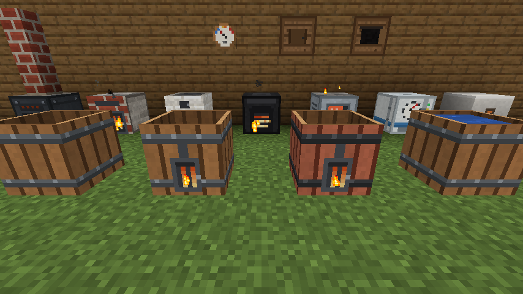

# Bathhouse — мод про бани (NeoForge 1.21.1)



Три типа бань, которые **собираются из факторов**: температура, влажность, дым, отделка стен
и приборы (каменки, печи, парогенератор). Каждая готовая баня даёт **долгий эффект —
40 минут, как «Герой деревни»**. Плюс купели для контраста и отмокания.

| Тип (в игре) | Прообраз | Температура | Влажность | Стены | Обязательный прибор | Топка | Эффект |
|---|---|---|---|---|---|---|---|
| **Туманница** | хаммам | 35–50 °C | 90–100 % | камень ≥ 50 % | парогенератор | только по-белому | **Чистота**: медленная регенерация, иммунитет к яду, голоду и тошноте |
| **Парильня** | русская баня | 60–80 °C | 40–70 % | дерево ≥ 50 % | дровяная печь с камнями | по-белому / по-серому / по-чёрному | **Крепость**: +4 к здоровью, +1 к урону, +10 % к сопротивлению отбрасыванию |
| **Калильня** | финская сауна | 80–110 °C | 5–15 % | дерево ≥ 50 % | любая печь с камнями | по-белому / по-серому / по-чёрному | **Лёгкость**: +10 % к скорости бега, атаки и добычи |

Выше 120 °C баня перестаёт быть баней: начинается урон от перегрева (огнестойкость защищает).

## Как это работает

1. Постройте закрытую комнату (парную): от 6 до 300 блоков воздуха. Двери и люки должны быть закрыты.
2. Повесьте на стену **банный термогигрометр**. Он находит комнату (заливкой воздуха) и раз в секунду
   считает её климат. Затем определяет тип бани и выдаёт эффекты всем, кто внутри.
3. Поставьте у стен или внутри приборы и растопите. Комната греется постепенно: в парной 3×3×3
   на одной каменке это несколько минут. Большой комнате нужно больше печей.
4. Поддавайте пар **ковшом** (или ведром/бутылкой воды) на камни. Чем горячее камни, тем больше пара.
   Холодные камни пар не дают, а каждый ковш немного остужает камни.
5. Пробудьте в готовой бане **60 секунд**. Прогресс показан над хотбаром. После этого вы получаете эффект.

ПКМ по термогигрометру выдаёт подробный отчёт: объём, отделку, климат, приборы, тип топки,
что уже готово и **чего не хватает** до ближайшего типа бани. Компаратор у термогигрометра
выдаёт температуру (°C / 8).

### Факторы

- **Отделка.** Блоки различаются по теплопотерям и теплоёмкости:
  - дерево (брёвна, доски, деревянные ступени и полублоки, двери) — тёплое;
  - камень (каменные кирпичи, кальцит, кварц, полированные породы, бетон, терракота) — держит тепло;
  - стекло — сильно теряет тепло;
  - шерсть и ковры — лучший утеплитель.
  
  Списки заданы тегами `bathhouse:bath_wood`, `bath_stone`, `bath_glass`, `bath_insulation`.
- **Температура** берётся от приборов минус потери через стены. Уличная температура зависит от биома:
  зимой и в тундре баню топить дольше.
- **Влажность** считается физично, через абсолютную влажность. Одно и то же количество пара даёт
  меньший процент при более высокой температуре. Чугунная печь сушит воздух, открытое волоковое окно
  и дымоход в потолке понемногу вытягивают пар.
- **Дым** важен для бань по-серому и по-чёрному (см. ниже).

### По-белому, по-серому, по-чёрному

- **По-белому:** на каждой дровяной печи стоит свой **дымоход**, дым в парную не попадает.
- **По-серому:** у печи нет своей трубы, но в потолке или стене парной встроен **дымоход**.
  При топке дым проходит через парную и уходит в трубу. Немного дымно, зато нагрев быстрый.
  Баня готова при дыме ≤ 35 %. Эффект длится в 1,5 раза дольше.
- **По-чёрному:** дымохода нет вообще. Дым уходит только через дверь и **волоковое окно**.
  Пока горят дрова, в парной угарно. Нужно дождаться прогорания, проветрить (открыть дверь или окно),
  закрыть и только потом париться. Баня готова при дыме ≤ 10 %. Эффект на **уровень сильнее**.
- **Туманница** топится только по-белому.

Угар опасен: при дыме ≥ 40 % накладывается тошнота, при ≥ 60 % — слабость и замедление,
при ≥ 85 % — отравление.

## Приборы

| Блок | Питание | Особенности |
|---|---|---|
| Внутренняя каменка | дрова, уголь (ПКМ, Shift+ПКМ — всё что влезет, воронки) | мощная, камни 200–300 °C, под пар |
| Выносная каменка | топливо | встраивается в стену **топкой наружу** — дым остаётся снаружи |
| Кирпичная печь | топливо | долго греется, долго держит жар, есть закрытая каменка |
| Чугунная печь | топливо | греет быстро и сушит воздух; камней нет |
| Электрокаменка | редстоун (мощность ∝ сигналу) | не дымит, есть камни |
| Парогенератор | редстоун + вода (вёдра или трубы, 8 вёдер) | даёт пар и немного тепла |
| Тёплый мраморный лежак | редстоун | в туманнице парение на нём идёт ×2 |
| Дымоход | — | на печи → по-белому; в потолке → по-серому |
| Волоковое окно | ПКМ — открыть/закрыть | выпускает дым, пар и немного тепла |

Топливо в банных печах горит в 4 раза дольше, чем в обычной печке.

### Инструменты

- **Банный ковш.** Набирает воду из источника или котла (8 порций). ПКМ по каменке поддаёт пар,
  в купели отчерпывает воду.
- **Банный веник.** Только для **парильни**: +4 с к парению и немного лечения.
  В сухом жаре калильни веник пересыхает и обжигает.
- **Рукавица-скребок.** Пилинг в **туманнице**: +4 с к парению и немного лечения.

## Купели

| Купель | Среда | Температура | Правила | Награда |
|---|---|---|---|---|
| **Студёная** | вода (ведро → полная) | 4–12 °C | только **после парильни или калильни** (в течение 2 мин); окунание **10–30 с**; не прыгать с разбега | **Закалка**: +2 к броне, +1 к прочности брони, не замерзаешь в рыхлом снегу |
| **Горячая** | вода, дровяная печка | 38–42 °C | вода **не выше груди** (уровень 2 из 3, лишнее отчерпнуть ковшом); не нырять (Shift); не сидеть дольше 2,5 мин | **Нега I**: +1 к удаче, мягкие падения |
| **Опилочная** | опилки, дровяная печка | 45–50 °C | то же; опилки отгребаются Shift+ПКМ | **Нега II** |

- Студёную купель охлаждают льдом, плотным или синим льдом, снегом и снежками. Без льда вода
  принимает температуру биома: зимой она студёная сама.
- Печка горячей и опилочной купели сама прикрывает заслонку на верхней границе температуры.
- Цветок в горячей или опилочной купели — это «травы»: эффект длится в 1,5 раза дольше.
- Без прогрева в парной студёная купель даёт **холодовой шок** (замедление и слабость).
  Слишком долгое окунание приводит к переохлаждению. Прыжок с разбега считается резким окунанием
  и вызывает тошноту. В этих случаях контраст не засчитывается.
- В горячей купели дольше положенного возникает перегрузка сердца: тошнота и слабость.

## Рецепты (кратко)

- Термогигрометр: доски, стеклянная панель, медь, редстоун.
- Каменки и печи: печка (furnace) + булыжник / кирпичи / железо.
- Электрокаменка: булыжник, железо, редстоун.
- Парогенератор: железо, стекло, котёл, редстоун.
- Лежак: кальцит, медь, редстоун.
- Дымоход: 6 кирпичей → 4 шт.
- Волоковое окно: деревянный люк + железная решётка.
- Ковш: миска + палка.
- Веник: 3 листвы + палка + нить.
- Рукавица: шерсть + кожа + нить.
- Опилки: бревно → 8 шт.
- Студёная купель: 2 железа + 5 досок.
- Горячая купель: студёная купель + печка + железо.
- Опилочная купель: студёная купель + печка + опилки.

Полный список рецептов — в `src/main/resources/data/bathhouse/recipe`.

## Настройки

Файл `serverconfig/bathhouse-server.toml` в папке мира:

- длительность сеанса;
- длительность эффекта (по умолчанию 48000 тиков = 40 минут);
- бонусы бань по-серому и по-чёрному;
- допустимый объём комнаты;
- скорость симуляции климата;
- урон от перегрева и угара;
- времена для купелей.

## Сборка и тесты

```bash
cd bathhouse
./gradlew build              # jar окажется в build/libs/
./gradlew runClient          # запустить игру с модом
./gradlew runGameTestServer  # 12 внутриигровых тестов (комнаты, классификация, нагрев, эффекты, купели)
```

Текстуры рисуются скриптом `tools/gen_textures.py`, JSON-модели, рецепты и теги — скриптом
`tools/gen_resources.py` (нужен Python 3 и Pillow).
