# Create: Radar Fire Control (`radar_fcs`)

Аддон для **Create**, **Create Big Cannons** и **Create: Radars** (NeoForge 1.21.1): вычислитель управления огнём,
контроллеры наводки, радарный линк и радарный монитор. Цели дают радары **Create: Radars**; вычислитель сопровождает
их, решает баллистику с упреждением, поворачивает пушки через контроллеры наводки и стреляет, только когда ствол
действительно наведён и на линии огня нет своих.

Пушки: всё, что ставится на станок CBC, — большие пушки (в том числе со скорострельным затвором и картриджами),
автопушки и пулемёты CBC, **CBC Advanced Technologies** (нарезные стволы, тяжёлые и спаренные автопушки, ракетные
установки), **CBC Neo Warfare** (роторные и средние пушки) и другие аддоны. Станки — станок CBC и **компактные станки
CBC: Firepower Components** (обычный и для автопушек).
Цели: мобы (враждебные; мирные — через белый список), игроки, контрапшены Create, лодки, вагонетки
и прочие сущности, корабли **Create Aeronautics / Sable**. Белый и чёрный списки целей у каждого вычислителя,
ручное наведение с монитора (своего или Create: Radars). **Перехват** летящих снарядов больших пушек и ракет
(с модом CBC Interception): фильтр угрозы, типы и приоритеты.

## Как собрать батарею
1. **Пушка** на станке CBC или на компактном станке CBC: Firepower Components.
2. **Контроллеры наводки** вплотную к станку: **горизонтальной** — под станком, **вертикальной** — сбоку.
   Вращение подаётся валом в контроллер (горизонтальному — снизу, вертикальному — с противоположной от станка стороны).
3. **Радар Create: Radars** (плоский радар, радарный подшипник и др.) — работающий.
4. **Вычислитель** где угодно и **радарные линки** на вычислитель, станки, радар (и, если нужно, монитор) — все в одной
   **радарной сети**, как складские передатчики Create. Автоматического подключения по радиусу нет — только линки.
5. **Электричество (FE)** — вычислителю 1024 FE/т, монитору, транспондеру и блокам памяти — свои нормы
   (см. «Электропитание»): генераторы Create Crafts & Additions или любой мод с FE.

## Обучающие сцены (Ponder)
Как в Create: наведите курсор на предмет мода и **удерживайте W** — откроется сцена с объяснением (русский и
английский). Сцены: батарея (вычислитель, пушка, радар), **настройки вычислителя** (все вкладки по порядку),
контроллеры наводки, радарная сеть и блок памяти, радарный монитор (окно и его вкладки), транспондер (режимы зоны,
наследование), камеры и монитор камер, **своё орудие на подшипниках-шарнирах Create Aeronautics** (курс и наклон
через приводы орудия, прицел, линки, тип «кастом»), вращатель орудия, привод орудия и настройки орудия. Все блоки мода
собраны в категории «Управление огнём» указателя Ponder.

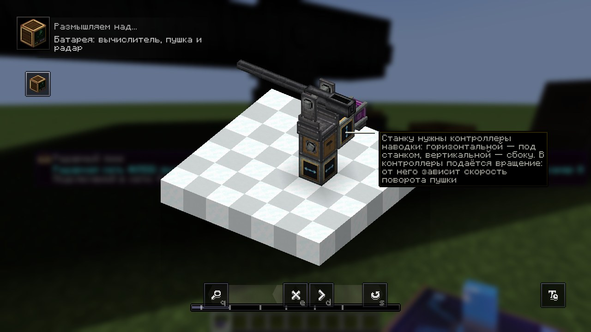

## Контроллеры наводки
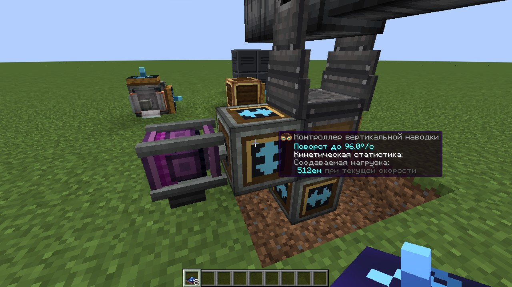

- **Контроллер горизонтальной наводки** (↔) — вплотную под станком CBC (под подвесным — над ним), вал снизу.
- **Контроллер вертикальной наводки** (↕) — вплотную сбоку станка, вал с другой стороны.
- **Компактный станок** (CBC: Firepower Components): пушка стоит сбоку от станка, поэтому вертикальный контроллер —
  на любой другой боковой грани (удобно — со стороны входа наклона), горизонтальный — снизу или сверху.
  Ограничитель, вставленный в компактный станок, действует и на вычислитель.
- Контроллер поворачивает пушку ровно на нужный угол в нужную сторону по команде вычислителя. Скорость поворота —
  от скорости вала, как у валов CBC: **256 об/мин = 9.6°/тик (192°/с)**, 64 об/мин = 2.4°/тик. Для целей 70 м/с
  подавайте 128–256 об/мин. Нагрузка — 4 ед. стресса на об/мин (`controllerStress`).
- Выходной вал контроллера (к станку) показывает текущий угол пушки, входной крутится вместе с сетью.
- Без контроллера статус пушки «нет контроллера наводки», без вращения — «нет вращения на контроллере наводки»;
  такая пушка не наводится и не стреляет. Очки инженера показывают скорость поворота и нагрузку.

### Пределы поворота (ползунок, как у торсионной пружины)
У **контроллеров наводки** и **приводов орудия** на боковой грани **два значка** — по одному на каждое направление,
пределы независимы. Навести взгляд на значок и **удерживать ПКМ** — откроется ползунок Create:
- курс — **◀ влево** (левый значок) и **▶ вправо** (правый), наклон — **▲ вверх** (верхний) и **▼ вниз** (нижний);
- от **1 до 360°**, правый край ползунка — **∞ (без предела, по умолчанию)**; на значках видны пределы, их же
  показывают очки инженера; копируются планшетом (clipboard) Create.

Откуда отсчёт:
- контроллер курса — от направления ствола при сборке пушки (у компактных станков FPC ствол может быть собран и
  против стороны станка — отсчёт всё равно от ствола), контроллер наклона — от горизонта;
- привод курса — от направления орудия в тот момент, когда предел включили (снять все пределы — ноль забывается),
  привод наклона — от горизонта основания.

Как ведёт себя пушка: через запретный сектор она не поворачивает, а идёт **в обход** (например, предел вправо 270°,
влево 10° — к цели слева сзади пушка повернёт вправо). Угол считается с оборотами: при пределе 360° пушка не
закрутится больше чем на оборот. Цель за пределом пушка пропускает и берёт следующую; если других нет — стоит у
ближайшего к цели предела со статусом **«вне сектора»** и не стреляет. С камерой — так же: взгляд за предел —
пушка у предела. Если в одну сторону предела нет, цель «за пределом» с другой стороны достижима обходом.

## Радары Create: Radars
Цели берутся с работающих радаров Create: Radars в радарной сети вычислителя (и монитора, если он есть).
Вычислитель уточняет каждую цель по живой сущности каждый тик (корабли — по физике Sable), поэтому точность огня
не зависит от периода обзора радара. Без работающего радара в сети огня нет (статус «нет радара») — кроме цели,
назначенной вручную на мониторе: её вычислитель ведёт сам.

## Радарный монитор
Ставьте мониторы стеной (до 6x6) — они сложатся в один экран. Картинку дают радары Create: Radars радарной сети
монитора (линк — на любом блоке экрана).
- **Карта** вокруг монитора: монитор — в центре, **вверх на экране — направление от вас**, когда вы стоите перед
  монитором; буква «С» у края — север. Сторона карты **вводится числом** в окне монитора — от 16 до 1 000 000 блоков
  (по умолчанию 256; Enter или уход с поля — применить; колесо мыши над полем — шаги 16…1 000 000, с Shift — через шаг);
  на прямоугольной стене — по меньшей стороне, по длинной видно больше. Масштаб **не меняется** сам.
- **Шкала дальности — на обеих осях, как на координатной плоскости**: засечки на **1/4, 2/4, 3/4 и 4/4**
  (у края квадрата карты) в обе стороны от монитора; вправо и вверх — положительные расстояния, влево и вниз — со
  знаком минус (карта 256 — «32 м», «64 м», «96 м», «128 м» и «-32 м» … «-128 м»; от 1000 м — в км); линии сетки — по тем
  же долям. Подписи — поочерёдно по разные стороны оси; подпись, которой не хватает места (налезает на соседнюю,
  букву севера, строки состояния или подписи целей), не пишется.
- **Метки на карте** — только для глаз, на огонь не влияют: ПКМ по карте в окне монитора — поставить метку,
  ПКМ по метке — убрать; вкладка «Метки» — цвет, имя (до 24 символов), координаты X/Z, удалить, «Добавить (где
  стою)». До 32 меток на экран, сохраняются в мире; видны и на экране в мире (кольцо с точкой и подпись), взгляд на
  метку — её координаты и дальность. Фильтр «Метки» на вкладке «Вид».
- **Радары сети — метки** (по умолчанию зелёный ромб) и их **зоны действия**: у вращающегося радара (радарный
  подшипник) — круг дальности, у неподвижного — сектор обзора в его сторону. И метки, и зоны **отключаются** и
  **настраиваются** на вкладке «Вид»: у меток — форма, цвет, размер; у зон — заливка или только контур, цвет,
  яркость заливки. Зона радара за краем карты видна той частью, что попадает на карту.
- **Луч сканирования** вращается вместе с антенной: курс берётся у самого радара на каждом кадре (с поправкой
  внутри тика, как у антенны в мире), поэтому луч плавный при любом FPS и не отстаёт даже на **256 об/мин**
  (77° за тик); за лучом — затухающий след, на высоких оборотах длиннее.
- Показываются **все цели** радаров. Значок — по типу (по умолчанию: игроки — треугольник, враждебные — квадрат,
  мирные — круг, корабли — крупный ромб, контрапшены — крупный квадрат, снаряды — мелкий крест, прочие — мелкий круг),
  цвет — по состоянию: оранжевые — угрозы, голубые — мирные мобы и прочие сущности, зелёные — свои (транспондер,
  владелец, команда), серые — неактивные (стоят на месте), красные — по ним ведётся огонь; жёлтая рамка — назначенная
  цель, зелёные ромбы — радары, голубые кольца — наземные транспондеры (базы) с именами.
- **Имена**: корабль или контрапшен с транспондером подписан именем транспондера (имя корабля), наземный
  транспондер — своим. Подписи — **всегда** или **только при наведении** курсора (настройка монитора); действует и
  на экране в мире, и в окне монитора. Подписи не налезают друг на друга: близкие сдвигаются на строку, лишние
  (менее важные) скрываются — под курсором и назначенная цель важнее.
- **Взгляд на экран** — курсор; отметка под ним в белой рамке, вверху экрана — имя, состояние, координаты,
  дальность, высота и скорость цели (так же для назначенной цели).
- **Нажатие колеса мыши по отметке** (клавиша «выбрать блок») — **исключить цель из огня**: вычислители сети монитора
  по ней не стреляют, отметка серая и перечёркнута, в сведениях — «исключена из огня». Повторное нажатие — вернуть.
  Исключение снимается и само, когда цель пропала с радаров (вышла из зоны): вернётся — огонь снова. Назначение
  цели (ПКМ) тоже снимает с неё исключение. Работает и в окне монитора (на карте и в списке целей).
- **ПКМ по отметке** — ручное наведение: назначить цель вычислителям сети монитора, они бьют по ней в первую очередь,
  в обход типов целей, списков и окна скорости (но не по своим и не в обход запретов сервера). ПКМ мимо отметок —
  снять назначение. Назначение держится, пока его не снимут или цель не пропадёт (`designationTicks`).
- **Shift+ПКМ** — окно монитора с вкладками:
  - **Экран** — та же карта (с зонами и лучами радаров): наведение курсора — сведения о цели, клик — назначить или снять, масштаб, подписи;
  - **Цели** — список целей (клик — назначить или снять);
  - **Вид** — фильтры показа по типам (игроки, враждебные, мирные, корабли, контрапшены, снаряды, прочие,
    транспондеры, радары, зоны радаров, а также свои и неактивные) и значок каждого типа: форма (квадрат, круг,
    треугольник, ромб, крест, кольцо), цвет («по состоянию» или постоянный) и размер; у зон радаров — заливка или
    контур, цвет и яркость; сторона карты (16…1 000 000 блоков), режим подписей;
  - **Метки** — метки игрока на карте (см. выше).
- Стена мониторов — **сплошной экран** без видимых стыков блоков; при взгляде на экран рамка выделения блока не
  рисуется (курсор — свой).
- Свои и чужие на экране — по правилу «свой-чужой» (коды транспондеров) первого вычислителя сети монитора.

**Монитор Create: Radars** тоже можно поставить в сеть линком: цель, выбранная на нём игроком, — ручное
наведение для вычислителей сети (так же, как на своём мониторе).

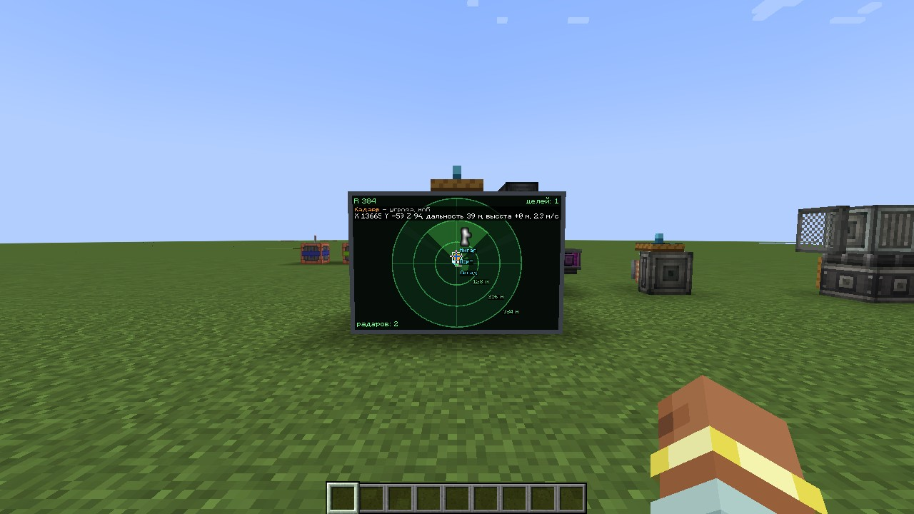
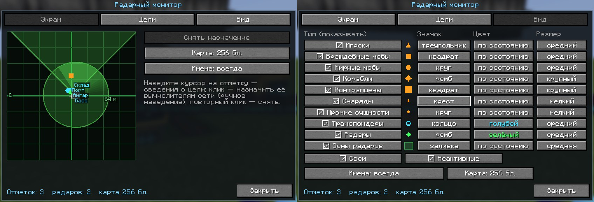

## Вычислитель управления огнём
Подключается **радарной сетью** (радарные линки) к станкам, радарам и мониторам — на любом расстоянии.

- **ПКМ** — экран настроек (у каждого вычислителя свои, сохраняются в блоке). Вкладка «Состояние» — сводка:
  радары, пушки, их состояние, расчётный промах и разброс ствола, активные цели, линки — и кнопки
  **«Собрать пушки»** / **«Разобрать пушки»** (все пушки вычислителя сразу; разобранные он не собирает, пока не нажата
  «Собрать», — удобно для перезарядки и перестройки).
  Если разброс пушки большой (жёлтым), удлините ствол или уменьшите заряд — так CBC сужает разброс.
- **Shift+ПКМ** — запретить или разрешить огонь (наведение продолжается).
- **Очки инженера Create** — та же сводка. **Display Link** — источник «Цели СУО». **Компаратор** — число целей.

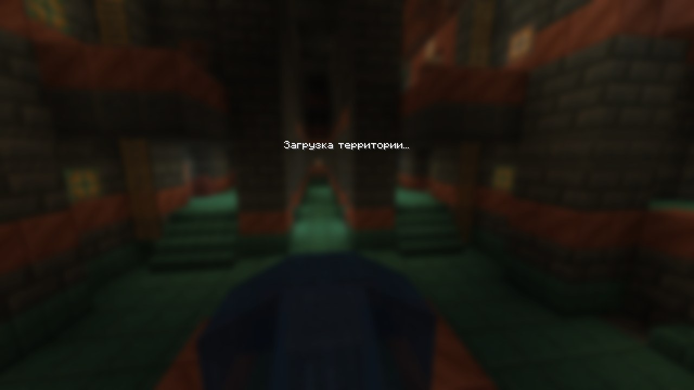

### Настройки вычислителя (ПКМ)
Числа крутятся **колесом мыши** над полем (или кнопками «−/+»): дробные (скорость, время) — до 1 шагом 0,1, дальше
шагом 1; целые — шагом 1; **с Shift шаг в 10 раз больше**. Время — в секундах с шагом 0,1 с.

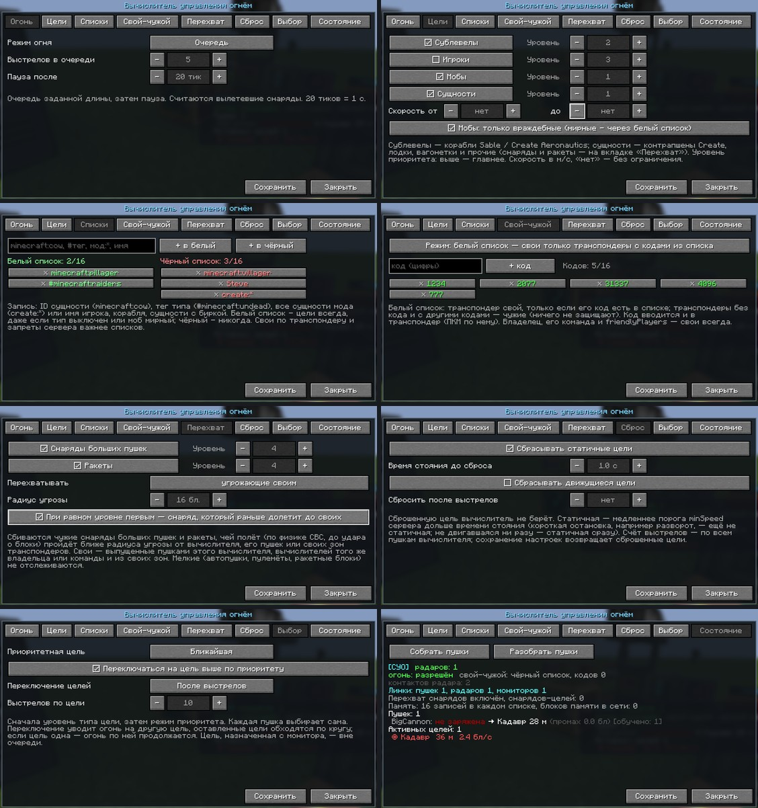

| Вкладка | Настройка | Варианты |
|---|---|---|
| Огонь | режим огня | **одиночный** (выстрел, пауза), **автоматический** (без пауз), **очередь** (N выстрелов, пауза) |
| | выстрелов в очереди, пауза | 2–100; пауза 0,1–60 с («нет» — без паузы) |
| Цели | типы целей | **сублевелы** (корабли Sable / Create Aeronautics), **игроки** (по умолчанию выключены), **мобы**, **сущности** (контрапшены, лодки, вагонетки и прочие); снаряды и ракеты — на вкладке «Перехват» |
| | уровень приоритета типа | 1–5, выше — главнее (по умолчанию игроки 3, сублевелы 2, мобы и сущности 1) |
| | скорость от / до | **у каждого типа своя** (и у снарядов с ракетами на вкладке «Перехват»), м/с от 0,1; «нет» — без ограничения |
| | мобы: только враждебные | включено по умолчанию: мирные мобы — только через белый список |
| Списки | белый список | цели всегда, даже если их тип выключен или моб мирный |
| | чёрный список | никогда не цели |
| Свой-чужой | режим | **белый список кодов** (свои — только транспондеры с кодами из списка) или **чёрный список кодов** (свои — все транспондеры, кроме кодов из списка; по умолчанию, пустой) |
| | коды | коды по 1–8 цифр; видят и меняют только владелец вычислителя, его команда и операторы |

В каждом списке (белый, чёрный, коды) — **16 записей**, и ещё **+16 за каждый блок памяти** с питанием в радарной сети
вычислителя. Записи сверх памяти хранятся, но не действуют (серые на экране). Длинные списки прокручиваются колесом мыши.
| Сброс | статичные / движущиеся | не брать стоящие (по умолчанию) или движущиеся цели |
| | время стояния до сброса | 0–60 с (по умолчанию 1 с): цель, которая двигалась, считается статичной, только простояв столько; короткая остановка (разворот) — ещё не статичная. Это же время — для переключения «при остановке» |
| | после N выстрелов | каждое орудие делает по цели свои N выстрелов и больше её не берёт; когда её сбросили все орудия, цель сброшена для вычислителя. Несколько снарядов одного выстрела (картечь, спаренные стволы) — один выстрел, станки одного орудия — общий счёт. Сохранение настроек сбрасывает список |
| Выбор | приоритетная цель | ближайшая, наиболее ранняя (дольше всех на радаре), наиболее дальняя, крупнейшая, наименьшая, самая быстрая, самая медленная |
| | переключение по приоритету | перейти на цель выше уровнем (или заметно лучше по режиму), как только она появилась; выключено — держать текущую |
| | переключение между целями | отсутствует, после N выстрелов, через время, при остановке; оставленные цели обходятся по кругу, единственная цель остаётся под огнём |

Запись списка: ID сущности (`minecraft:cow`), тег типа (`#minecraft:undead`), все сущности мода (`create:*`) или имя
(игрока, корабля, сущности с биркой); регистр не важен. Свои по транспондеру и запреты сервера важнее списков.

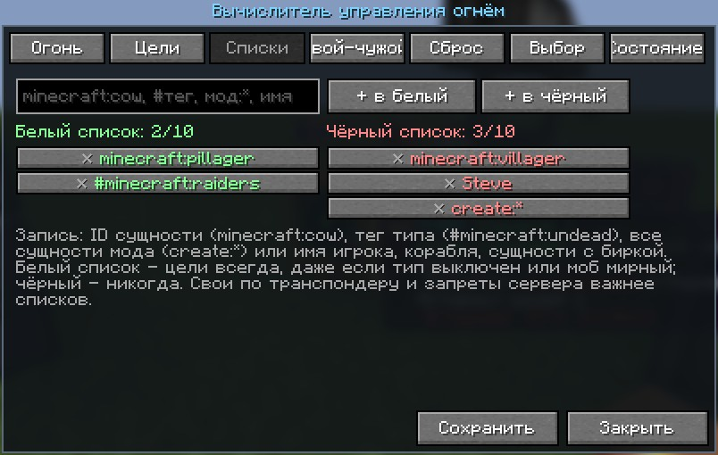

Порядок выбора: уровень типа цели → режим приоритета; назначенная с монитора цель — вне очереди. Выстрелы считаются
по снарядам, вылетевшим из ствола. Конфиг сервера (`targets.*`) — верхняя граница: тип, запрещённый на сервере,
не берётся, даже если включён в настройках (на экране помечен ⚠).

### Радарный линк
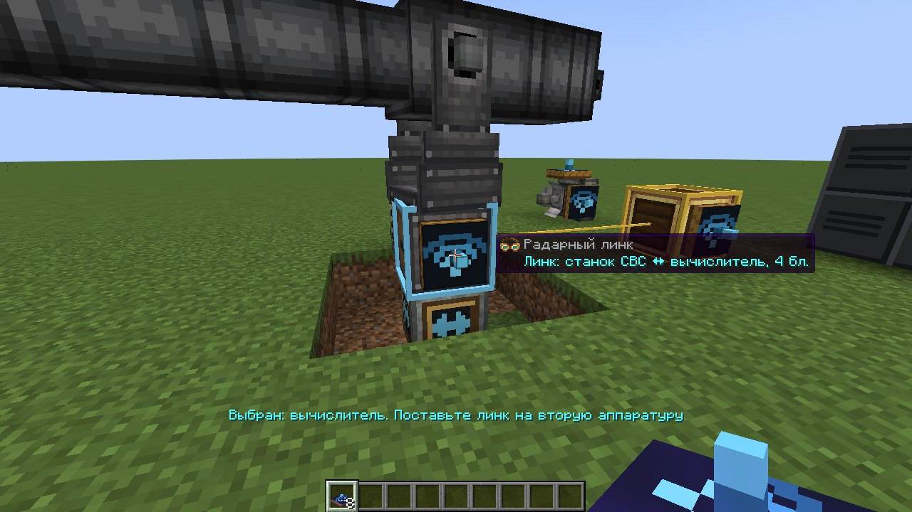

Единственный способ подключить аппаратуру. Работает как **складской передатчик Create**: каждый линк — участник
**радарной сети**, вся аппаратура с линками одной сети связана со всей, расстояние не ограничено (в пределах измерения).
1. **Поставьте линк** на вычислитель, станок, радар Create: Radars, свой монитор или монитор Create: Radars.
   Ненастроенный линк начинает **новую сеть** (в чате — её имя, например «#3F2A»).
2. **ПКМ линком по стоящему линку** — предмет настроен на его сеть (светится). Следующие линки встают в эту сеть.
3. **Shift+ПКМ в воздух** или **сетка крафта** — сбросить настройку предмета.

Что даёт сеть: вычислитель управляет всеми станками сети, берёт цели со всех её радаров и назначения с её мониторов;
монитор рисует цели радаров сети и показывает, по каким целям стреляют её вычислители. Аппаратура может стоять
в нескольких сетях (несколько линков на разных гранях).

Взгляд на линк подсвечивает всю аппаратуру его сети, настроенный линк в руке — тоже (зелёная рамка — сюда можно
поставить линк). Очки инженера и ПКМ по линку — имя сети и сколько в ней вычислителей, пушек, радаров и мониторов.
**Полный сигнал редстоуна** (15) отключает линк. Сломали аппаратуру — линк отваливается. Рецепт: передатчик Create,
2 медных слитка, электронная лампа, редстоун → 2 линка. Парные линки версий 0.6–0.7 продолжают работать.

### Лимит подключений сети
Радарная сеть держит **16 линков аппаратуры** — вычислители, пушки, радары, мониторы, камеры, мониторы камер,
части орудий на вращателях — и ещё **16 за каждый блок памяти** с питанием в этой сети. Линки самих блоков памяти
в счёт не входят. Если линков больше, работают подключённые раньше. Лишний линк пишет «сеть переполнена» (ПКМ, очки
инженера), его аппаратура выпадает из сети. Очки инженера на линке показывают, сколько линков занято и сколько
доступно.

### Камеры и монитор камер
- **Камера** ставится на любую грань: на стену (кронштейн), на потолок или на пол. Радарным линком она
  подключается к сети — или **без линка**, как фабричный датчик Create: ПКМ предметом камеры по радарному линку (или по
  камере, уже стоящей в сети) настраивает его на эту сеть (предмет светится), поставленная камера сразу в сети.
  Shift+ПКМ в воздух — сброс. Такая камера занимает одно подключение в лимите сети; сломанная камера сохраняет сеть
  в выпавшем предмете. Это поворотная камера наблюдения: цилиндр поворачивается по курсу, шар с объективом — по курсу
  и наклону. Голова поворачивается туда, куда смотрят через камеру, и **остаётся в последнем положении** (сохраняется
  в мире); следующий вход в камеру начинается с этого взгляда.
- **Монитор камер** (ПКМ) — список камер его радарной сети. Имя камеры можно поменять (Enter). «Смотреть» —
  вид из центра камеры (свой корпус не виден): мышь поворачивает взгляд, **ЛКМ — сигнал огня всем орудиям сети**,
  как редстоун силы 15 (зажатая ЛКМ — непрерывный сигнал: автопушки стреляют очередью, большие пушки — по нажатию),
  **Shift — выход**. Монитору нужно **64 FE/т за каждую камеру** его сети; без энергии через камеры не смотрят.
- Пока игрок смотрит через камеру, **автоприцеливание всех пушек сети на паузе**. Пушки, в том числе орудия на
  вращателях, наводятся туда, куда смотрит камера (до 384 блоков). Луч камеры видит и **постройки Sable**
  (корабли, поворотные части): точка взгляда — на их блоках. По движущемуся кораблю или сущности орудия берут
  **упреждение** по их скорости. Камера на движущейся постройке Sable — вид едет вместе с ней. Стреляют, только пока зажата ЛКМ (без проверки
  наводки — как ручной спуск).
- **Взгляд на само орудие** (его станок, пушку, прицел, вращатель, привод, линк или контроллер на них, поворотную
  часть на вращателе или подшипнике — любую постройку Sable этого орудия, кроме основания под приводом курса): это
  орудие **не поворачивается** — иначе оно «гонялось» бы за точкой взгляда, которая едет вместе с ним. Статус «камера
  смотрит на само орудие»; ЛКМ по-прежнему стреляет. Отвели взгляд — орудие сразу снова наводится.
- **Камера на самом орудии** (на его поворотной части) **смотрит сквозь своё орудие**: ствол, платформа и другие
  поворотные постройки этого орудия взгляду не мешают, точка взгляда — за ними. Вид едет вместе с постройкой плавно,
  в каждом кадре.
- **Какими орудиями управляет камера** — кнопка «Орудия» в строке камеры на мониторе: отмеченные орудия наводятся по
  её взгляду и стреляют по ЛКМ, остальные в это время сами ведут цели (или слушаются другой камеры — несколько
  игроков могут управлять разными орудиями одновременно). Ничего не отмечено — все орудия сети.
- Игрок вышел (Shift, отошёл от монитора, вышел из игры) — пушки сразу возвращаются к автоприцеливанию. Если клиент
  подвис или сеть лагает дольше половины секунды, пушки на это время тоже возвращаются к автоприцеливанию, а управление
  **продолжается само**, как только команды снова доходят, — перезаходить в камеру не нужно.
- Камерой одновременно управляет один игрок. Видно столько, сколько прогружено вокруг самого игрока.

### Орудия на вращателях и приводах
Любую постройку или станок CBC можно сделать **орудием**: вычислитель поворачивает его **вращателями** или
**приводами** так, чтобы **прицел** (или, без прицела, ствол станка CBC) смотрел в точку упреждения.
1. **Привод орудия** (без Sable) — как коробка передач Create: вал входа сзади, вал выхода спереди. Скорость выхода
   (от −100 % до 100 % входа) задаёт вычислитель. Выход крутит что угодно:
   - вал станка CBC — поворота (снизу) или наклона (сбоку), вместо контроллеров наводки;
   - подшипник с поворотной частью — например, **подшипник-шарнир Create Aeronautics** (через шестерни);
   - ваши шестерни и редукторы.

   **ПКМ пустой рукой** переключает режим: **курс** (↔) или **наклон** (↕). Передаточное число до орудия и
   направление вычислитель выучивает сам по тому, как поворачивается ствол или прицел. Если наводка поначалу
   «гуляет», через несколько секунд она успокаивается. Пример: курс — привод через шестерни на подшипник-шарнир,
   на его поворотной части станок CBC, наклон — второй привод в вал наклона станка. Или наоборот: курс — валом
   станка, наклон — подшипником.
2. **Вращатель орудия** (нужен Sable) — как подшипник Create. Поворотная часть собирается перед его выходом (FACING)
   по правилам клея. Вращение подаётся валом сзади: скорость поворота такая же, как у контроллеров наводки
   (0,0375°/тик на 1 об/мин). ПКМ пустой рукой — собрать: постройка становится под-уровнем Sable на шарнире.
   Повторный ПКМ показывает угол. Обычная схема — горизонтальный вращатель (выход вверх), на его поворотной части
   вертикальный (выход вбок), на нём ствол. Сначала собирайте внутренний (вертикальный), потом внешний.
3. **Прицел** — ставится объективом туда, куда смотрите. Обычно его ставят на ствол, вдоль ствола. Вычислитель
   наводит не блоки, а **направление прицела**, поэтому форма постройки не важна. Без прицела наводится ствол
   первого станка CBC орудия.
4. **Орудийный линк** — как радарный, но объединяет части **одного орудия**: прицел, вращатели, приводы и
   **станки CBC**. Ненастроенный линк начинает новое орудие. ПКМ им по стоящему орудийному линку настраивает
   предмет. Shift+ПКМ в воздух сбрасывает настройку. Лимита у орудийной сети нет.
5. **Настройки орудия** — Shift+ПКМ по орудийному линку: **имя** (видно в отчёте вычислителя), **тип** —
   автопушка, среднее орудие, большая пушка или **кастом** (наводится прямо на цель, без упреждения), **автоприцеливание**
   (выкл — орудие наводится только с камеры) и **стрельба** (выкл — орудие наводится, но само не стреляет; ЛКМ с камеры
   работает). На линке, стоящем на станке CBC, есть ещё **«Основная пушка»**: её ствол наводится, если в орудии нет
   прицела, и по ней считается баллистика (по умолчанию — первый найденный станок). Тип задаёт баллистику и вид сигнала орудия без станка CBC: автопушка и кастом — сигнал держится, пока
   орудие на цели, среднее и большое — импульсами. Со станком CBC баллистика и огонь — по станку.
6. **Радарный линк** — на **любую часть орудия** (прицел, вращатель, привод или станок) и в сеть вычислителя. Всё
   орудие подключается одним линком.

Огонь: **станки CBC орудия** (подключённые орудийным линком) стреляют по команде вычислителя, их баллистика
учитывается. Несколько станков в орудии стреляют вместе. Сам станок вычислитель не поворачивает и его валы не
блокирует: его крутят приводы или поворотные части. **Прицел всегда выдаёт сигнал редстоуна** (15), пока орудие
на цели и стрельба разрешена, в том числе когда в орудии есть станки: к нему можно подключить свои пушки. Орудие
без станков берёт цель прямой наводкой, без баллистики.

Станок CBC работает только на блоках: на поворотной части подшипника-шарнира или вращателя он стреляет, внутри
контрапшена обычного подшипника Create — нет. Своя постройка орудия — не цель и не помеха огню. Статусы: «нет
вращения на вращателе или приводе орудия», «орудие без вращателей и приводов», «не собрана» (вращатель или
пушка не собраны).

### Свой-чужой: транспондеры и коды
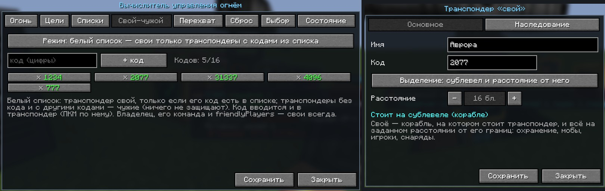

**Транспондер** (ПКМ — его экран):
- **Имя** — название корабля или базы (до 32 символов): им подписаны цель у вычислителя и отметка на мониторе.
- **Код** — комбинация цифр (1–8, можно без кода). По коду вычислитель решает, свой это транспондер или чужой.
- **Режим выделения** — что своё. Внутри зоны своё **всё**: мобы (и враждебные), игроки, транспорт, контрапшены,
  снаряды, корабли:
  - **сублевел, на котором стоит** — корабль Sable / Create Aeronautics (или контрапшен Create) с транспондером и всё
    в его пределах (границы корабля + 2 блока: палуба, борта); не на корабле транспондер в этом режиме ничего не
    защищает (экран предупредит);
  - **радиус** — шар заданного радиуса вокруг транспондера (1–`maxTransponderRadius`, по умолчанию `iffRadius` = 12);
    на корабле зона едет вместе с ним, и сам корабль тоже свой;
  - **сублевел и расстояние от него** — корабль и всё на заданном расстоянии от его границ (охранение, десант рядом
    с бортом); не на корабле — как радиус.
- Режим по умолчанию — по месту: на корабле «сублевел», на земле «радиус». Через свою зону по цели снаружи
  вычислитель не стреляет.
- **Наследование** (вкладка экрана транспондера) — кто в зоне получает её защиту:
  - **типы**: игроки, враждебные мобы, мирные мобы, корабли, контрапшены, снаряды, прочие сущности (по умолчанию —
    все); например, без враждебных мобов зомби на палубе своего корабля остаётся целью;
  - **«всегда»** — белый список (наследуют, даже если тип выключен) и **«никогда»** — чёрный список (не наследуют
    никогда), по 16 записей: ID сущности (`minecraft:villager`), тег (`#minecraft:raiders`), все сущности мода
    (`create:*`) или имя игрока; чёрный список важнее белого;
  - корабль (контрапшен), на котором стоит транспондер, свой всегда.

  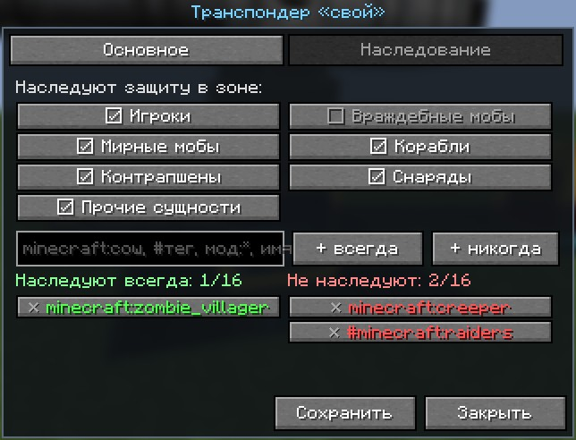
- Снаряды и ракеты свои **по месту запуска**: выпущенные из своей зоны (или своей батареей) — свои, чужой снаряд,
  влетевший в зону, — цель для перехвата (см. «Перехват снарядов и ракет»).
- **Питание**: 64 FE/т; без энергии транспондер ничего не защищает. Транспондер в движущемся контрапшене Create питания
  не требует (блок контрапшена его получить не может).
- Настройки видят и меняют только **владелец** (кто поставил), его команда и операторы — чужой не подсмотрит код.
- Краситель меняет только цвет.

**Вкладка «Свой-чужой» вычислителя** — правило для кодов (16 кодов, +16 за каждый блок памяти):
- **белый список** — свои только транспондеры с кодами из списка; транспондеры без кода и с другими кодами — чужие
  (их корабли и зоны не защищены);
- **чёрный список** — свои все транспондеры (и без кода), кроме кодов из списка.

Пример: у своих транспондеров код 2077, у вычислителя белый список «2077» — корабль противника с транспондером без кода
или с другим кодом остаётся целью. Монитор показывает своих по правилу первого вычислителя своей сети.
Независимо от кодов свои — владелец вычислителя, его команда, `friendlyPlayers`, корабли-носители батареи;
лодка или вагонетка со своим игроком внутри — своя.

### Свои цели у отдельных пушек
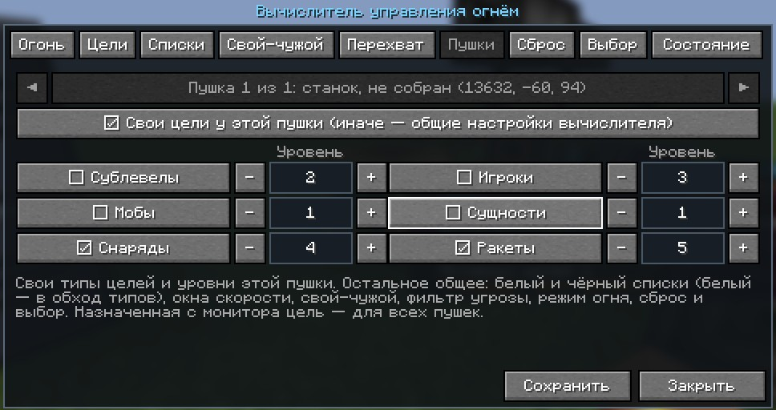

Вкладка **«Пушки»**: выберите пушку (◀ ▶ — все подключённые к вычислителю, с типом и координатами станка) и включите
**«свои цели»** — тогда у неё свои **разрешённые типы целей** (сублевелы, игроки, мобы, сущности, снаряды, ракеты)
и свои **уровни приоритета**. Пушки без своих целей берут общие настройки вкладок «Цели» и «Перехват». Например:
одна автопушка только сбивает снаряды и ракеты, другая бьёт мобов, большая пушка — только корабли.

- Тип, разрешённый только какой-то пушке (а в общих настройках выключенный), всё равно сопровождается — им займётся
  та пушка.
- Общее для всех пушек: белый и чёрный списки (белый — в обход типов), окна скорости, свой-чужой, фильтр угрозы,
  режим огня, сброс и выбор. Цель, назначенная с монитора, — для всех пушек.
- В отчёте у такой пушки пометка «[свои цели]».

### Перехват снарядов и ракет
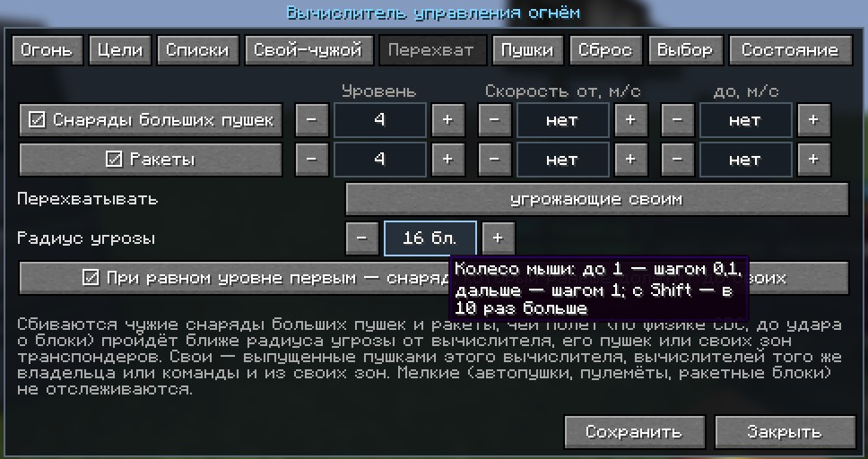

Вычислитель сбивает летящие **снаряды больших пушек** (CBC и аддонов: болванки, фугасные, бронебойные, шрапнель...)
и **ракеты** (средние ракеты CBC Advanced Technologies и его исправления, ракеты CBC Enchanced Shells). Для этого
нужен мод **CBC Interception** (`cbcintercept`): без него снаряды CBC пролетают друг сквозь друга, поэтому
вычислитель их видит (и монитор показывает), но не стреляет — на вкладке и в отчёте будет предупреждение
(`interception.requireInterceptionMod`).

- **Мелкие снаряды не отслеживаются вовсе**: патроны автопушек и пулемётов (в том числе тяжёлых автопушек CBC-AT,
  средних и роторных пушек Neo Warfare), ракеты ракетных блоков, стрелы и прочее — их бывает очень много.
  Теги типов сущностей меняют выбор: `radar_fcs:intercept_shells`, `radar_fcs:intercept_rockets` — добавить,
  `radar_fcs:intercept_ignored` — исключить.
- **Вкладка «Перехват»** вычислителя:
  - **типы**: снаряды больших пушек и ракеты — каждый со своим **уровнем приоритета** 1–5 (по умолчанию 4: выше мобов,
    кораблей и игроков — летящий снаряд опаснее);
  - **перехватывать**: **угрожающие своим** (по умолчанию) — прогноз полёта (физика CBC, до удара о блоки) проходит
    ближе **радиуса угрозы** (16 блоков) от вычислителя, его пушек или своих зон транспондеров; **приближающиеся** —
    всё, что летит к вычислителю; **все чужие**;
  - **порядок**: при равном уровне первым — снаряд, который раньше долетит до своих (иначе — по режиму приоритета
    вкладки «Выбор»);
  - белый и чёрный списки действуют и на снаряды: например, `createbigcannons:smoke_shell` в чёрном списке —
    дымовые не сбивать.
- **Свои снаряды** не сбиваются: выпущенные пушками этого вычислителя, вычислителей того же владельца или команды,
  своим игроком, из своей зоны транспондера.
- **Как целится.** Снаряд большой пушки ведётся по физике CBC от его точного положения и скорости (сопротивление,
  гравитация из свойств снаряда) — прогноз совпадает с полётом; ракета — по замерам (скорость точная, разгон по
  изменению скорости). Встреча считается так же, как её проверяет CBC Interception: пути обоих снарядов за тик —
  отрезки, сближение меньше суммы половин их размеров плюс `extraHitRadius` мода (0.5); первые 2 тика полёта снаряд
  не сталкивается, снаряды «одного залпа» (почти одинаковая скорость) — тоже, поэтому догонять снаряд сзади
  вычислитель не будет. Радары Create: Radars видят снаряды (категория снарядов радара).

Игровые тесты (автопушка, 4 ствола, пулемётные патроны, с CBC Interception 1.0.0):

| Что летит на батарею | Сбито в воздухе | Патронов |
|---|---|---|
| болванки 100 м/с с 90 блоков, по дуге, прямо и сбоку | 6 из 6 | 15 |
| болванки 160 м/с с 130 блоков, с трёх сторон | 6 из 6 | 10 |
| средние ракеты CBC-AT под тягой | 5 из 5 | 10 |
| болванки, цели — только с плоского радара Create: Radars | 5 из 5 | 10 |

### Блок памяти
Ставится в радарную сеть вычислителя (линком) и добавляет каждому его списку 16 записей. Нужно питание 240 FE/т;
без энергии не работает (огни на панели гаснут). Рецепт: латунный корпус, 4 электронные лампы, 2 компаратора,
2 редстоуна (лампы по углам, компараторы сверху и снизу, редстоун по бокам корпуса).

### Электропитание
Блоки мода работают от электричества **FE** (Forge Energy): генератор (alternator) и аккумуляторы
**Create Crafts & Additions**, провода и любые другие моды с FE. Энергию принимает любая грань блока, запас — 2 секунды
работы. Устройства других модов (станки CBC, радары Create Radars) питания не требуют, контроллеры наводки работают
от вращения.

| Блок | Потребление | Без энергии |
|---|---|---|
| Вычислитель | 1024 FE/т | не видит целей, пушки не наводятся и не стреляют (статус «нет энергии») |
| Блок памяти | 240 FE/т | не добавляет записей к спискам |
| Транспондер | 64 FE/т | не защищает |
| Радарный монитор | 32 FE/т за блок экрана | экран погашен; энергию можно подать в любой блок стены |
| Монитор камер | 64 FE/т за каждую камеру сети | через камеры не смотрят, просмотр прерывается |

Генератор Crafts & Additions на 256 об/мин даёт около 360 FE/т — вычислителю нужно 3 генератора или аккумулятор.
Значения настраиваются в конфиге сервера (`energy.*`), `energy.requirePower = false` отключает требование.

## Как работает
1. **Обнаружение.** Радары Create: Radars на линках дают отметки, вычислитель сопровождает цели по живой сущности
   каждый тик (корабли — по физике Sable, прицел в центр масс). Без работающего радара огня нет.
2. **Треки.** Скорость и ускорение — взвешенный МНК по окну замеров. При резком манёвре (большая невязка)
   окно укорачивается, и по цели не стреляют, пока оценка не устоится (обычно 5–6 тиков после разворота).
   Неподвижные и медленные цели (`minSpeed`) по умолчанию неактивны (настройка «сбрасывать статичные»).
3. **Приоритет.** Назначенная с монитора цель, иначе по настройкам вычислителя (по умолчанию ближайшая к каждой пушке;
   текущую держим, пока новая не станет заметно лучше).
4. **Баллистика.** Модель полёта повторяет CBC: гравитация, сопротивление, скорость по зарядам или стволам,
   смещение дульного среза, разброс ствола. С **CBC Advanced Technologies** скорость и разброс большой пушки считаются
   по его физике выстрела (газ зарядов и сопротивление стволов) — первый выстрел тоже точный.
   Упреждение ищется методом секущих — сходится и для целей, чья скорость сравнима со скоростью снаряда.
5. **Потиковый перехват.** Minecraft проверяет попадание раз в тик: отрезок полёта снаряда за тик против цели на конец тика.
   Поэтому вычислитель целится в положение цели на конец того тика, в котором снаряд проходит эту точку.
   Для мелких быстрых целей (цель за тик пролетает больше своего размера) это и есть разница между попаданием и промахом.
6. **Момент выстрела.** CBC берёт направление выстрела не из текущего положения ствола: большая пушка стреляет сразу,
   по положению на начало тика, автопушка — в следующем тике. Вычислитель ведёт ствол с опережением на этот тик и
   стреляет, когда снаряд из **фактического** положения ствола заденет цель. Как и в CBC, проверяется отрезок полёта
   против габарита цели, расширенного на размер снаряда: у мобов и игроков — точный габарит (высокую цель можно бить
   выше или ниже центра), у кораблей и контрапшенов — по центру с допуском. Встреча «впритирку» к границе тика не
   засчитывается: доля блока по траектории перенесла бы её на соседний тик. У автопушек промах считается для каждого
   следующего выстрела очереди, запас — по разбросу ствола. Линия огня проверяется заново, как только точка встречи
   сместилась (быстрая цель за край стены — огня нет).
7. **Обучение по выстрелам.** Вычислитель следит за снарядом и уточняет скорость, вынос дульного среза и модель полёта
   (ракеты CBC-AT, в том числе с медленным стартом и разгоном из исправления CBC-AT, снаряды аддонов).
   Снаряд, пробивший цель, резко тормозит — этот участок в модель не записывается.

### Быстрые цели (игровые тесты)
| Цель | Пушка | Снаряды в цель |
|---|---|---|
| 70 м/с поперёк линии огня, 40 блоков | автопушка, 4 ствола | 97 % (85 % с учётом снарядов, летевших в момент разворота цели) |
| 100 м/с поперёк линии огня | автопушка, 4 ствола | 100 % (78–87 %) |
| 70 м/с, пикирует со сближением | автопушка | 100 % (82–86 %) |
| корабль Sable 3x3x3, 70 м/с | три большие пушки, по выстрелу | 3 из 3 без CBC-AT; 1–3 из 3 с CBC-AT (его разброс ±1.9° у тестовой пушки) |

Пушки из реальной сборки (CBC 5.11.7, CBC-AT 0.1.4c + исправление CBC-AT 1.1.4, CBC Neo Warfare 0.0.6v)
по той же цели 70 м/с; средняя и большая пушки перезаряжаются тестом (как автоматом заряжания). Пока пушка пуста,
вычислитель проверяет заряжание каждые 2 тика: средняя пушка с автоматом на 5 тиков стреляет раз в 10 тиков (было 21):

| Пушка | Расчёт вылета против факта | Снаряды в цель |
|---|---|---|
| стальная автопушка, 3 ствола, бронебойные патроны | 0.00° и 0.00 блока, скорость точно | 97–100 % (81–83 %) |
| бронзовая роторная пушка Neo Warfare, 3 ствола | 0.00° и 0.00 блока, скорость точно | 94–96 % (77–78 %) |
| незерстальная средняя пушка Neo Warfare, 3 ствола | 0.00° и 0.00 блока, скорость точно | 100 % (73 %) |
| стальная большая: скорострельный затвор, ствол + 4 нарезных CBC-AT, картридж 4/4 | скорость 7.60 точно, отклонение 0.01–0.3° (разброс CBC-AT) | 100 % (79–92 %) |

Первая цифра — снаряды, выпущенные не в момент разворота цели, в скобках — все. Цель в тестах разворачивается на 180°
мгновенно: снаряды, которые в этот момент уже летят, промахиваются при любом расчёте (настоящая цель так не умеет).
Расчётный путь снаряда совпадает с фактическим до сотых блока. Осколки бронебойных снарядов выстрелами не считаются.

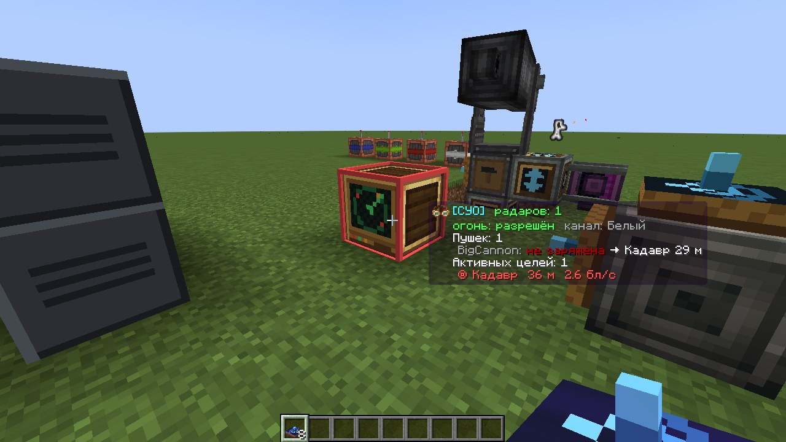

## Чем отличается от наведения самого Create: Radars
- Наведение с упреждением по скорости и ускорению цели, потиковый перехват, обучение баллистики по выстрелам —
  попадания по целям 70–100 м/с (см. таблицы выше).
- Цель уточняется по живой сущности каждый тик, а не по отметке радара; ручное наведение работает и без радара.
- Огонь — только когда снаряд из фактического положения ствола заденет цель и на траектории нет своих.
- Настройки режимов огня, типов целей, сброса, приоритета и переключения у каждого вычислителя.

## Настройка
Серверный конфиг: `world/serverconfig/radar_fcs-server.toml`. Основное:

| Параметр | По умолчанию | Смысл |
|---|---|---|
| `monitor.designationTicks` | 0 | сколько держится назначение цели с монитора, тиков; 0 — пока его не снимут или цель не пропадёт |
| `sensor.minSpeed` | 0.6 | цели медленнее (блоков/с) неактивны |
| `targets.allow*` | всё разрешено | верхняя граница для настроек вычислителей: `allowMobs`, `allowPlayers`, `allowShips`, `allowContraptions`, `allowProjectiles` (перехват снарядов и ракет), `allowOtherEntities` |
| `interception.requireInterceptionMod` | true | сбивать снаряды только с модом CBC Interception (без него снаряды пролетают друг сквозь друга) |
| `iff.iffRadius` | 12 | радиус нового транспондера (режим «радиус») |
| `iff.maxTransponderRadius` | 64 | наибольший радиус, который можно задать транспондеру |
| `energy.requirePower` | true | блокам мода нужно электричество (FE) |
| `energy.fireControlUsage` / `memoryUsage` / `transponderUsage` / `monitorUsage` | 1024 / 240 / 64 / 32 | потребление, FE/т (монитор — за блок экрана) |
| `aiming.requireRotation` | true | станок поворачивают контроллеры наводки, скорость — от их валов (как у валов CBC) |
| `aiming.shaftSpeedMultiplier` | 1.0 | множитель скорости поворота от контроллеров |
| `aiming.controllerStress` | 4 | нагрузка контроллера наводки, ед. стресса на об/мин |
| `aiming.slewDegPerTick` | 6 | скорость поворота без контроллеров и кинетики (`requireRotation = false`) |
| `aiming.fireToleranceDeg` | 0.2 | допуск выстрела по кораблям и контрапшенам (по мобам — точный габарит) |
| `aiming.rapidFireMarginBlocks` | 0.1 | запас промаха очереди автопушки сверх разброса ствола |
| `aiming.discreteIntercept` | true | потиковое упреждение (для быстрых мелких целей) |
| `aiming.fireMinTrackTicks` | 6 | не стрелять по цели, которую сопровождаем меньше стольких тиков |
| `sensor.scanIntervalTicks` | 1 | период замеров целей |
| `firing.learnFromShots` | true | уточнять баллистику по выстрелам |

## Совместимость
- Обязательно: Create 6.0.x, Create Big Cannons 5.10+, **Create: Radars 0.4.9.x или 5.x** (радары). Sable companion (MIT) встроен в jar.
- Не ставьте на те же станки auto yaw/pitch контроллеры Create: Radars — вычислитель уступает такие станки.
- Create Aeronautics / Sable — по желанию (корабли как цели, транспондер на кораблях, вращатели орудия, подшипник-шарнир с приводом орудия).
- Электричество — любой мод с FE; проверено с **Create Crafts & Additions** 1.6.0 (свежие 1.7.x требуют NeoForge 21.1.248+).
- **2.3.1** — пределы поворота в каждую сторону — **отдельные значки и ползунки** (◀ влево / ▶ вправо, ▲ вверх /
  ▼ вниз), полностью независимые. Исправлено: пушка на компактном станке, собранная стволом против стороны станка
  (зеркальные станки с двух сторон постройки), с пределами разворачивалась на 180° — отсчёт теперь от направления
  ствола при сборке.
- **2.3.0** — **пределы поворота** у контроллеров наводки и приводов орудия: ползунок Create на боковой грани (как у
  торсионной пружины), отдельно для каждого направления (влево/вправо, вверх/вниз), 1–360°, по умолчанию без предела.
  Пушка не поворачивает через запретный сектор (идёт в обход), цель за пределом пропускает, иначе стоит у предела
  («вне сектора»). Строка про пределы — в сценах Ponder контроллеров и привода.
- **2.2.2** — исправления камеры и загрузки чанков:
  - **зависание при взгляде с камеры на часть своего орудия** (и на любую постройку Sable): расстояние в углу вида
    считалось лучом, который Sable растягивал на миллионы блоков, — каждый кадр занимал секунды. Теперь луч свой и
    считается раз в тик;
  - **после зависания пушки не слушались камеру до перезахода**: сервер за время паузы снимал управление и дальше
    молча отбрасывал команды. Теперь управление продолжается со следующей же команды;
  - **лаги сервера при взгляде вдаль** (в небо, сквозь своё орудие): проверка линии огня подгружала и генерировала
    чанки вдоль траектории. Теперь лучи аппаратуры читают только уже загруженные чанки;
  - **«Сохранение мира» без конца при выходе**, если вычислитель и его пушка стоят в разных чанках: вычислитель,
    выгружаясь, обращался к пушке в соседнем чанке и возвращал его к жизни. Исправлено; заодно вычислитель больше не
    держит загруженными чанки далёких пушек;
  - пушка, оставшаяся «с зажатым спуском» после перезахода в мир во время стрельбы, отпускает спуск, как только
    вычислитель снова берёт её.
- **2.2.1** — камера, стоящая на орудии, смотрит сквозь своё орудие (раньше упиралась в его ствол или платформу, и
  орудие замирало или гонялось за точкой на себе); убраны «радиус 4 блока» и удержание из 2.2.0 — наведение с камеры
  снова откликается сразу. «Format error» в сцене привода орудия (знак % в тексте).
- **2.2.0** — сцены Ponder подробнее объясняют настройки (отдельная сцена про все вкладки вычислителя, окно монитора,
  транспондер, монитор камер, настройки орудия); своё орудие на Sable — на подшипниках-шарнирах Create Aeronautics.
  Камера на самом орудии: вид плавный, орудие не «гоняется» за точкой взгляда на любой своей поворотной части.
- **2.1.0** — обучающие сцены Ponder (как в Create, удерживать W над предметом) для всей аппаратуры: 8 сцен на
  русском и английском, категория «Управление огнём».
- **2.0.0** — камера, смотрящая на само управляемое орудие, его не поворачивает (раньше орудие дёргалось, гоняясь за
  точкой взгляда на себе); сброс после N выстрелов считает выстрелы каждого орудия отдельно (раньше счёт был общий
  на все пушки, и при нескольких пушках каждая стреляла по цели один раз).
- **1.9.0** — компактные станки **CBC: Firepower Components** (0.4.4; `compact_cannon_mount`,
  `compact_autocannon_mount`, вертикальный): работают везде, где станок CBC, — радарный и орудийный линк,
  контроллеры наводки, приводы орудия, камеры, сборка и разборка, огонь; ограничитель станка соблюдается.
- **1.8.0** — текстуры всех блоков 32×32 (вычислитель с экраном РЛС, память, монитор камер, линки, антенны,
  транспондер, вращатель, приводы, контроллеры наводки, прицел); основная пушка орудия (Shift+ПКМ по орудийному линку на
  станке); выбор орудий для каждой камеры на мониторе камер, несколько камер управляют разными орудиями одновременно.
- **1.7.2** — новые текстуры камеры (кронштейн с винтами, цилиндр с прорезями и светодиодом, объёмный шар, панель
  с объективом, подсветкой и датчиком); камера подключается к радарной сети без линка (как фабричный датчик Create).
- **1.7.1** — наведение с камеры на постройки Sable (корабли): луч попадает в их блоки, по движущимся — с упреждением;
  вид камеры на движущейся постройке едет вместе с ней.
- **1.7.0** — вид камеры из её центра, свой корпус не виден; ЛКМ с камеры — прямой сигнал огня всем орудиям сети;
  монитор камер — 64 FE/т за камеру; настройки орудия (Shift+ПКМ по орудийному линку): имя, тип (автопушка, среднее,
  большая, кастом без упреждения), автоприцеливание, стрельба.
- **1.6.1** — камера наблюдения новой модели: поворотный цилиндр и шар-голова поворачиваются туда, куда смотрят
  через камеру, и сохраняют последнее положение; вход в камеру начинается с него.
- **1.6.0** — привод орудия (управляемое вращение на подшипник или вал станка CBC, курс или наклон); станки CBC
  в орудийной сети стреляют, без прицела наводится их ствол; сигнал прицела — и при станках; валы станков орудия
  не блокируются.
- **1.5.0** — общий лимит подключений радарной сети (16 линков + 16 за блок памяти); камеры и монитор камер (вид от
  камеры, наведение пушек сети по взгляду, ЛКМ — огонь, автоприцеливание на паузе); орудия на вращателях Sable: вращатель
  орудия, прицел, орудийный линк.
- **1.4.2** — деления шкалы дальности на четверти: 1/4, 2/4, 3/4, 4/4.
- **1.4.1** — шкала дальности на обеих осях, с отрицательными числами влево и вниз.
- **1.4.0** — сторона карты до 1 000 000 блоков; метки игрока на карте (вкладка «Метки», ПКМ по карте); шкала
  дальности с засечками на 1/3, 1/2, 2/3 и у края; радарный линк больше не уезжает с антенной радара (отражатели
  Create Radars «липкие» и утаскивали прилегающий линк).
- **1.3.0** — сторона карты вводится числом (16–4096 блоков, колесо — шагами); нажатие колеса мыши по отметке
  исключает цель из огня вычислителей сети монитора, повторное — возвращает, уход цели с радаров снимает исключение.
- **1.2.0** — монитор стал **картой** со стороной 64–2048 блоков (монитор в центре, север подписан); радары сети —
  отключаемые и настраиваемые метки, их зоны действия (круг или сектор) — тоже; луч сканирования крутится вместе с
  антенной на каждом кадре (проверено на 256 об/мин); слои экрана рисуются без записи глубины — не мерцают ни на
  каком расстоянии.
- **1.1.1** — подписи дистанций у кругов монитора.
- **1.1.0** — монитор: лучи по настоящим радарам, постоянный авто-масштаб, без мерцания слоёв («сетки») издалека;
  свои снаряды больше не считаются «своими на линии огня» (большая пушка не ждёт, пока её снаряд улетит);
  на перезарядке ствол держит наводку по последнему снаряду.
- **1.0.0** — первая стабильная версия (код 0.14.0).
- **С версии 0.14** у пушек могут быть свои цели (вкладка «Пушки»); вкладок экрана настроек стало 9.
- **С версии 0.13** окно скорости у каждого типа целей своё (старое общее окно переносится во все типы), время
  переключения хранится в тиках (`SwitchTicks`, старые секунды переносятся).
- **С версии 0.12** снаряды и ракеты — отдельные типы целей (вкладка «Перехват», уровень 4, включены): отслеживаются
  только снаряды больших пушек и ракеты, сбиваются — с CBC Interception. Свои снаряды определяются по месту запуска
  (раньше — по месту, где снаряд сейчас). Тип «сущности» больше не включает снаряды.
- **С версии 0.11** у транспондера есть имя и наследование защиты (по умолчанию наследуют все типы — как в 0.10),
  у монитора — значки по типам (новые формы по умолчанию), подписи имён и фильтр «Транспондеры» (включён).
- **С версии 0.10** блоки мода требуют электричество (FE), зона транспондера бережёт всё внутри (и врагов), списки —
  16 записей + 16 за блок памяти (было 10 и 16).
- **С версии 0.9** «свой-чужой» — по кодам транспондеров и вкладке «Свой-чужой» вычислителя; каналы-красители
  вычислителей, мониторов и транспондеров больше не действуют (по умолчанию — чёрный список без кодов: свои все
  транспондеры). Если команды на сервере различались цветами, задайте транспондерам коды, а вычислителям — списки.
- **С версии 0.8** линки — сети, как у складских передатчиков (старые парные линки работают), ключи `targets.*`
  в конфиге сервера новые (`allow*`, всё разрешено; старые `target*` не переносятся), зона наземного транспондера
  больше не прикрывает врагов.
- **С версии 0.7 своих радаров нет** (радарный подшипник, решётка, купол удалены — в мирах они исчезнут), автоподключения
  по радиусу нет: подключите пушки, радары и мониторы радарными линками и поставьте контроллеры наводки к станкам.
- **CBC Advanced Technologies 0.1.4c без исправлений не работает с CBC 5.11.4 и новее** (`NoSuchMethodError ... onRecoil`
  при выстреле). Используйте CBC 5.11.3 или **CBC: Advanced technologies crash fix** (`cbcatfix`, проверено 1.1.4 на CBC 5.11.7):
  с ним ракеты стартуют медленно и разгоняются двигателем (вычислитель выучивает разгон за 1–2 выстрела),
  пусковая — не длиннее 3 блоков вместе с казёнником, ракете нужно топливо (собранная на верстаке его имеет).
- **CBC Neo Warfare** (порт CBC Modern Warfare, проверено 0.0.6v): роторная пушка ведётся как автопушка,
  средняя — как большая (выстрел по фронту сигнала); скорость и разброс — по материалу и числу стволов, точка вылета —
  как у самой пушки. Средней пушке нужен автомат заряжания: без патрона в казённике статус «нет боеприпасов».
- **CBC: Firepower Components** (проверено 0.4.4): компактные станки — как станок CBC; углы ставятся через сам
  станок (с его ограничителем), блокировка валов — через его входы вращения. Автоматический контроллер огня FPC
  и сигнал вычислителя складываются (стреляет любой из них).
- **CBC Advanced Technologies**: его переработанная физика выстрела больших пушек учитывается (скорость и разброс);
  если в его конфиге `disablePhysicRework = true`, считается по формулам CBC.
- После обновления с версий до 0.4 ключи наведения в конфиге новые (`requireRotation`, `fireToleranceDeg`,
  `rapidFireMarginBlocks`, `scanIntervalTicks`, `extraLatencyTicks`): старые значения не переносятся.

## Сборка
```bash
./gradlew build              # jar в build/libs/
./gradlew coreTest           # офлайн-тест баллистики и треков
./gradlew runGameTestServer  # 102 игровых теста (моды скачиваются в run/mods)
./gradlew runGameTestServer -PfcsMinimal   # то же только с обязательными Create, CBC и Create Radars
./gradlew runGameTestServer -PfcsNoCbcAt   # без CBC Advanced Technologies
./gradlew runGameTestServer -PfcsNoFpc     # без CBC: Firepower Components
./gradlew runGameTestServer -PfcsProbe     # с подробным разбором каждого выстрела в логе
./gradlew runGameTestServer -PfcsExtraMods=<папка>   # плюс jar'ы из папки (CurseForge: cbcatfix, CBC Neo Warfare; CBC Interception)
```
