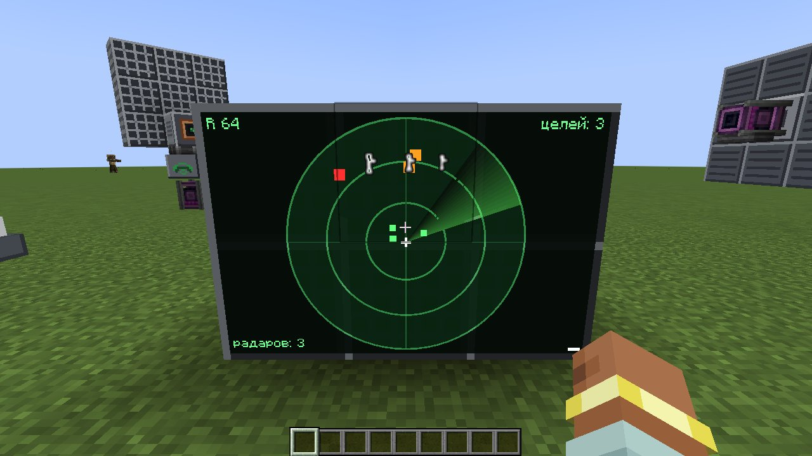
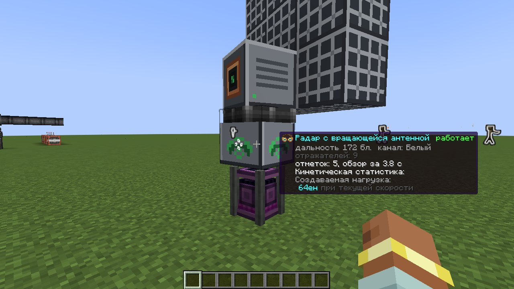
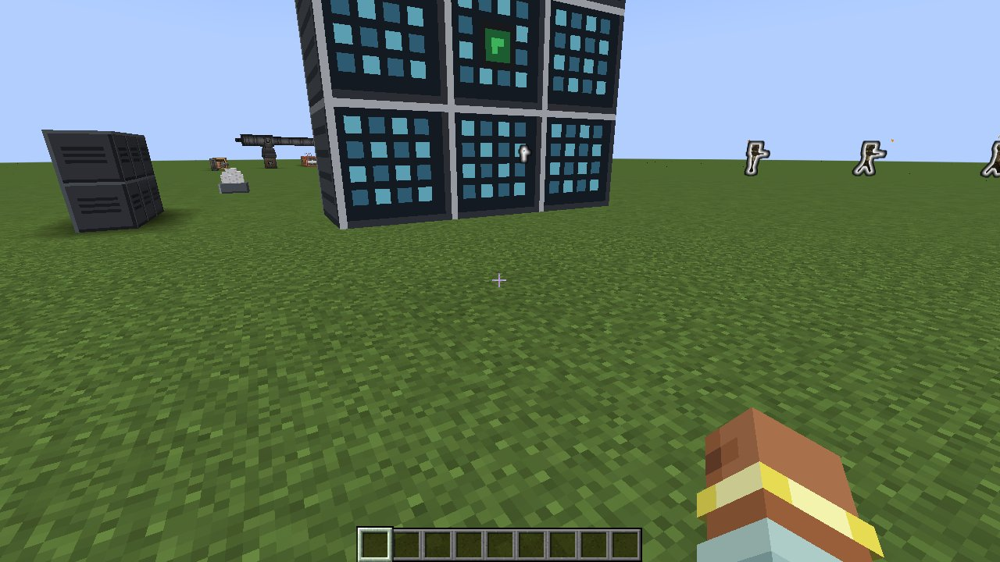
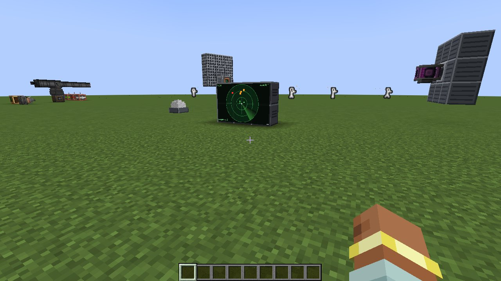
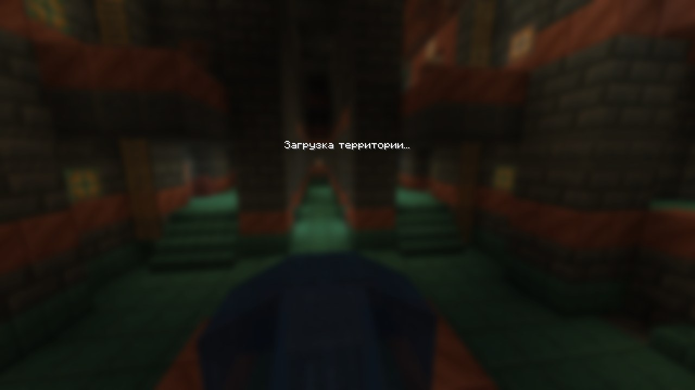
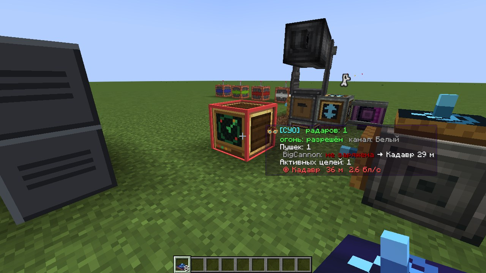

# Create: Radar Fire Control (`radar_fcs`)

Аддон для **Create** и **Create Big Cannons** (NeoForge 1.21.1): свои радары, радарный монитор и
вычислитель управления огнём. Вычислитель сам находит пушки, сопровождает цели, решает баллистику
с упреждением и стреляет, только когда ствол действительно наведён и на линии огня нет своих.

**Create: Radars больше не нужен.** Если он установлен, его радары тоже работают как источник целей.

Пушки: всё, что ставится на станок CBC, — большие пушки, автопушки и пулемёты CBC,
**CBC Advanced Technologies** (тяжёлые и спаренные автопушки, ракетные установки) и другие аддоны.
Цели: мобы, игроки (по настройке), контрапшены Create и корабли **Create Aeronautics / Sable**.



## Радары
Все радары работают по одной модели: дальность зависит от размера цели (крупное видно дальше),
блоки перекрывают луч, отметка гаснет, если цель долго не видна. Связки и провода не нужны:
радар обслуживает все вычислители и мониторы **своего канала** (цвет красителя) в радиусе `networkRange` (256 блоков).
**ПКМ красителем** по радару — канал. **Очки инженера** — состояние, дальность, число отметок, период обзора.

### Радар с вращающейся антенной (мультиблок)
**Радарный подшипник** + антенна из **облучателя** и **отражателей**.
- Поставьте подшипник «вверх», на него облучатель, вокруг облучателя — отражатели (любой формы).
  Блоки антенны сцепляются между собой сами, суперклей не нужен.
- Подайте вращение: антенна собирается и крутится сама (как подшипник Create).
- Луч идёт туда, куда смотрел облучатель при установке. Радар видит то, через что прошёл луч.
- Каждый отражатель добавляет дальность (64 + 12 за отражатель, до 384). Чем быстрее вращение, тем чаще обновляются отметки.
- Своя вращающаяся антенна (и чужие антенны) целью не считается.



### Фазированная решётка (мультиблок)
**Контроллер** + **панели** в одной плоскости вокруг него (любой формы, до 64 панелей).
- Смотрит в сторону, куда смотрели вы при установке; новая панель встаёт так же, как соседняя.
- Обзор сектора ±60° без движущихся частей. Вал подключается сзади к контроллеру.
- Панели добавляют дальность (48 + 10 за панель, до 320) и нагрузку на кинетику. Скорость вала задаёт период обзора.



### Радарный купол
Один блок, круговой обзор на 48 блоков, кинетика не нужна. Сигнал редстоуна выключает. Для небольших баз.

## Радарный монитор
Ставьте мониторы стеной (до 6x6) — они сложатся в один экран.
- Круговая развёртка вокруг монитора: **вверх на экране — направление от вас**, когда вы стоите перед монитором.
- Показываются только **активные чужие цели**: свои (транспондер, владелец, команда) и неподвижные скрыты.
  Оранжевые — цели, красные — по ним ведётся огонь, жёлтая рамка — назначенная цель, зелёные — радары канала.
- **ПКМ по отметке** — назначить цель: все вычислители канала бьют по ней в первую очередь.
  ПКМ мимо отметок — снять назначение.
- **Shift+ПКМ** — масштаб (авто, 32…1024 блоков). **Краситель** — канал.



## Вычислитель управления огнём
Поставьте рядом (до 16 блоков) со станками CBC. Радар канала может стоять где угодно в радиусе 256 блоков.

- **Станку нужно вращение**: вал снизу поворачивает станок, вал сбоку — наклоняет ствол (как при ручном управлении CBC).
  Скорость поворота — как от валов CBC: 256 об/мин дают 9.6°/тик. Без вращения статус «нет вращения на валах станка»,
  и пушка не стреляет, даже если цель случайно на линии огня. Для целей 70 м/с подавайте 128–256 об/мин на оба вала.
- **ПКМ** — отчёт в чат: радары, пушки, их состояние, расчётный промах и разброс ствола, активные цели.
  Если разброс пушки большой (жёлтым), удлините ствол или уменьшите заряд — так CBC сужает разброс.
- **Shift+ПКМ** — запретить или разрешить огонь (наведение продолжается).
- **ПКМ красителем** — канал (радары и «свой-чужой»).
- **Очки инженера Create** — та же сводка. **Display Link** — источник «Цели СУО». **Компаратор** — число целей.



### Транспондер «свой-чужой»
- На земле — защищает всё в радиусе `iffRadius` (база). На корабле Sable — весь корабль свой.
  В контрапшене Create — весь контрапшен свой.
- **ПКМ красителем** — канал: разные команды используют разные цвета.

## Как работает
1. **Обнаружение.** Радары канала дают отметки, вычислитель сопровождает цели по живой сущности каждый тик
   (корабли — по физике Sable, прицел в центр масс). Без радара огня нет (`requireRadar`).
2. **Треки.** Скорость и ускорение — взвешенный МНК по окну замеров. При резком манёвре (большая невязка)
   окно укорачивается, и по цели не стреляют, пока оценка не устоится (обычно 5–6 тиков после разворота).
   Неподвижные и медленные цели (`minSpeed`) неактивны.
3. **Приоритет.** Назначенная с монитора цель, иначе ближайшая к каждой пушке (держим, пока новая не станет заметно ближе).
4. **Баллистика.** Модель полёта повторяет CBC: гравитация, сопротивление, скорость по зарядам или стволам,
   смещение дульного среза, разброс ствола. С **CBC Advanced Technologies** скорость и разброс большой пушки считаются
   по его физике выстрела (газ зарядов и сопротивление стволов) — первый выстрел тоже точный.
   Упреждение ищется методом секущих — сходится и для целей, чья скорость сравнима со скоростью снаряда.
5. **Потиковый перехват.** Minecraft проверяет попадание раз в тик: отрезок полёта снаряда за тик против цели на конец тика.
   Поэтому вычислитель целится в положение цели на конец того тика, в котором снаряд проходит эту точку.
   Для мелких быстрых целей (цель за тик пролетает больше своего размера) это и есть разница между попаданием и промахом.
6. **Момент выстрела.** CBC берёт направление выстрела не из текущего положения ствола: большая пушка стреляет сразу,
   по положению на начало тика, автопушка — в следующем тике. Вычислитель ведёт ствол с опережением на этот тик и
   стреляет, когда снаряд из **фактического** положения ствола заденет цель. Как и в CBC, проверяется отрезок полёта
   против габарита цели, расширенного на размер снаряда: у мобов и игроков — точный габарит (высокую цель можно бить
   выше или ниже центра), у кораблей и контрапшенов — по центру с допуском. Встреча «впритирку» к границе тика не
   засчитывается: доля блока по траектории перенесла бы её на соседний тик. У автопушек промах считается для каждого
   следующего выстрела очереди, запас — по разбросу ствола. Линия огня проверяется заново, как только точка встречи
   сместилась (быстрая цель за край стены — огня нет).
7. **Обучение по выстрелам.** Вычислитель следит за снарядом и уточняет скорость, вынос дульного среза и модель полёта
   (ракеты CBC-AT, снаряды аддонов).

### Быстрые цели (игровые тесты)
| Цель | Пушка | Снаряды в цель |
|---|---|---|
| 70 м/с поперёк линии огня, 40 блоков | автопушка, 4 ствола | 97 % (85 % с учётом снарядов, летевших в момент разворота цели) |
| 100 м/с поперёк линии огня | автопушка, 4 ствола | 100 % (78–87 %) |
| 70 м/с, пикирует со сближением | автопушка | 100 % (82–86 %) |
| корабль Sable 3x3x3, 70 м/с | три большие пушки, по выстрелу | 3 из 3 без CBC-AT; 1–3 из 3 с CBC-AT (его разброс ±1.9° у тестовой пушки) |

Цель в тестах разворачивается на 180° мгновенно — снаряды, которые в этот момент уже летят, промахиваются при любом
расчёте (настоящая цель так не умеет). Расчётный путь снаряда совпадает с фактическим до сотых блока.



## Что исправлено по сравнению со связкой с Create: Radars
- Аддон больше не требует Create Radars: нет зависимости от его версий (API 0.4.9.x и 5.x различались).
- Радары смотрят туда, куда смотрел игрок при установке (плоский радар Create Radars сканировал в обратную сторону).
- Без связок и линкеров: сеть по цвету канала. Свои и неподвижные цели на мониторе не показываются.
- Цель назначается кликом по монитору, вычислитель сразу переключается на неё.
- Отметки — по центру цели, а не по ногам; крупные цели видны дальше, блоки закрывают обзор.

## Настройка
Серверный конфиг: `world/serverconfig/radar_fcs-server.toml`. Основное:

| Параметр | По умолчанию | Смысл |
|---|---|---|
| `radar.networkRange` | 256 | радиус сети радаров канала |
| `radar.requireLineOfSight` | true | радар не видит сквозь блоки |
| `radar.sizeAffectsRange` | true | крупные цели видны дальше (x0.6…x1.5) |
| `radar.bearing.*` | 64 + 12/отражатель, до 384 | дальность антенны, ширина луча, углы места |
| `radar.phasedArray.*` | 48 + 10/панель, до 320, ±60° | дальность, сектор, нагрузка на кинетику |
| `radar.dome.range` | 48 | дальность купола |
| `links.requireRadar` | true | без работающего радара огня нет |
| `sensor.minSpeed` | 0.6 | цели медленнее (блоков/с) неактивны |
| `targets.*` | мобы, корабли, контрапшены | кого атаковать; игроки выключены |
| `iff.iffRadius` | 12 | радиус защиты наземного транспондера |
| `aiming.requireRotation` | true | станок поворачивается только от вращения на валах (скорость как у CBC) |
| `aiming.shaftSpeedMultiplier` | 1.0 | множитель скорости поворота от валов |
| `aiming.slewDegPerTick` | 6 | скорость поворота без кинетики (`requireRotation = false`) |
| `aiming.fireToleranceDeg` | 0.2 | допуск выстрела по кораблям и контрапшенам (по мобам — точный габарит) |
| `aiming.rapidFireMarginBlocks` | 0.1 | запас промаха очереди автопушки сверх разброса ствола |
| `aiming.discreteIntercept` | true | потиковое упреждение (для быстрых мелких целей) |
| `aiming.fireMinTrackTicks` | 6 | не стрелять по цели, которую сопровождаем меньше стольких тиков |
| `sensor.scanIntervalTicks` | 1 | период замеров целей |
| `firing.learnFromShots` | true | уточнять баллистику по выстрелам |

## Совместимость
- Create 6.0.x, Create Big Cannons 5.10+. Sable companion (MIT) встроен в jar.
- Create: Radars 0.4.9.x и 5.x — по желанию: его радары рядом с вычислителем (16 блоков) тоже дают цели.
  Не ставьте на те же станки auto yaw/pitch контроллеры Create Radars — вычислитель уступает такие станки.
- Create Aeronautics / Sable — по желанию (корабли как цели, транспондер и радары на кораблях).
- **CBC Advanced Technologies 0.1.4c без исправлений не работает с CBC 5.11.4 и новее** (`NoSuchMethodError ... onRecoil`
  при выстреле). Используйте CBC 5.11.3 или мод-исправление для CBC-AT.
- **CBC Advanced Technologies**: его переработанная физика выстрела больших пушек учитывается (скорость и разброс);
  если в его конфиге `disablePhysicRework = true`, считается по формулам CBC.
- После обновления с версий до 0.4 ключи наведения в конфиге новые (`requireRotation`, `fireToleranceDeg`,
  `rapidFireMarginBlocks`, `scanIntervalTicks`, `extraLatencyTicks`): старые значения не переносятся.

## Сборка
```bash
./gradlew build              # jar в build/libs/
./gradlew coreTest           # офлайн-тест баллистики и треков
./gradlew runGameTestServer  # 18 игровых тестов (моды скачиваются в run/mods)
./gradlew runGameTestServer -PfcsMinimal   # то же только с Create и CBC (без Create Radars и Sable)
./gradlew runGameTestServer -PfcsNoCbcAt   # без CBC Advanced Technologies
./gradlew runGameTestServer -PfcsProbe     # с подробным разбором каждого выстрела в логе
```
