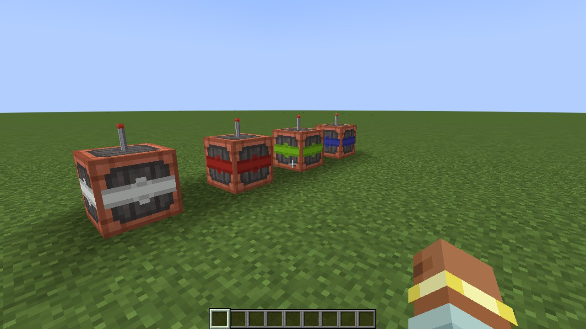

# Create Radars: Fire Control (`radar_fcs`)

Аддон для **Create: Radars** и **Create Big Cannons** (NeoForge 1.21.1). Улучшает автоматическое наведение
и огонь: сам находит пушки и радары, сопровождает цели, решает баллистику с упреждением и стреляет,
только когда ствол действительно наведён и на линии огня нет своих.

Работает со всеми пушками на станке CBC: большие пушки, автопушки и пулемёты CBC,
а также **CBC Advanced Technologies** (тяжёлые и спаренные автопушки, ракетные установки) и другие аддоны,
чьи пушки ставятся на станок CBC. Цели: мобы, игроки (по настройке), контрапшены Create
и корабли **Create Aeronautics / Sable**.


## Блоки

### Вычислитель управления огнём
Поставьте рядом (до 16 блоков) со станками CBC и радаром Create: Radars. Больше ничего настраивать не нужно.

- **ПКМ** — отчёт в чат: радар, пушки и их состояние, активные цели.
- **Shift+ПКМ** — запретить или разрешить огонь (наведение продолжается).
- **ПКМ красителем** — канал «свой-чужой».
- **Очки инженера Create** — та же сводка при наведении на блок.
- **Display Link** — источник «Цели СУО»: список активных целей на табло или мониторе.
- **Компаратор** — сила сигнала равна числу активных целей.

### Транспондер «свой-чужой»
- Стоит на земле — защищает всё в радиусе `iffRadius` (база).
- Стоит на корабле Sable / Create Aeronautics — весь корабль свой.
- Собран в контрапшен Create — весь контрапшен свой.
- **ПКМ красителем** — канал. Вычислитель считает своими только транспондеры своего канала:
  разные команды используют разные цвета.

## Как работает

1. **Обнаружение.** Раз в 2 секунды вычислитель находит станки CBC и радары рядом (plug & play).
   Станки, к которым приставлены auto yaw/pitch контроллеры Create Radars, он не трогает.
2. **Цели.** Радар Create Radars обнаруживает и назначает цели, вычислитель сопровождает их по живой
   сущности каждые 2 тика (корабли — по физике Sable). Без работающего радара огня нет.
3. **Треки.** Скорость и ускорение оцениваются взвешенным МНК по окну замеров.
   Неподвижные и очень медленные цели (`minSpeed`) неактивны: по ним нет огня и отметки.
   Свои цели (транспондер, владелец и его команда, `friendlyPlayers`) не отмечаются.
4. **Приоритет.** Каждая пушка берёт ближайшую к себе цель и держит её, пока новая не станет заметно ближе.
5. **Баллистика.** Модель полёта повторяет интегратор CBC: гравитация и сопротивление снаряда,
   скорость по зарядам (большие пушки) или по материалу и стволам (автопушки), смещение дульного среза.
   Решатель подбирает угол возвышения и итеративно считает упреждение с учётом движения цели.
6. **Обучение по выстрелам.** Вычислитель следит за вылетевшим снарядом и уточняет начальную скорость,
   положение дульного среза и модель полёта. Так он подстраивается под ракеты CBC-AT (тяга)
   и снаряды аддонов, которых не знает заранее.
7. **Наведение.** Станок поворачивается не быстрее `slewDegPerTick`, мелкие ошибки меньше `deadband`
   не отрабатываются. Валы станка блокируются, пока им управляет вычислитель.
8. **Огонь.** Только если фактический ствол в допуске: не меньше `aimTolerance` и не меньше углового размера цели.
   Так нет бесконечного доводения. Перед выстрелом траектория проверяется на своих и на блоки.
   Большие пушки стреляют импульсом, автопушки — очередью, пока цель в допуске.




## Отображение целей
- Активные цели светятся (эффект свечения) и отмечаются частицами (видно и корабли).
  Цель, по которой ведётся огонь, отмечается красным.
- Отчёт в чат, очки инженера, Display Link.

## Настройка
Серверный конфиг: `world/serverconfig/radar_fcs-server.toml`. Основное:

| Параметр | По умолчанию | Смысл |
|---|---|---|
| `links.linkRadius` | 16 | радиус поиска пушек и радаров |
| `links.requireRadar` | true | без работающего радара огня нет |
| `sensor.sensorMode` | AUTO | цели с радаров Create Radars или собственный сенсор (DIRECT) |
| `sensor.minSpeed` | 0.6 | цели медленнее (блоков/с) неактивны |
| `targets.*` | мобы, корабли, контрапшены | кого атаковать; игроки выключены |
| `iff.iffRadius` | 12 | радиус защиты наземного транспондера |
| `iff.requireLineOfSight` | true | не стрелять сквозь блоки |
| `aiming.aimTolerance` | 0.75 | минимальный допуск наведения, градусов |
| `aiming.slewDegPerTick` | 6 | скорость поворота станка |
| `aiming.requireShaftPower` | false | поворот не быстрее валов (как у CC:CBC) |
| `firing.learnFromShots` | true | уточнять баллистику по выстрелам |

## Совместимость
- Create 6.0.x, Create Big Cannons 5.10+, Create: Radars 0.4.9.x и 5.x.
- Create Aeronautics / Sable — по желанию (корабли как цели, транспондер на корабле, батарея на корабле).
- CBC Advanced Technologies и другие аддоны CBC — по желанию.
- Не ставьте на те же пушки auto yaw/pitch контроллеры Create Radars и не управляйте ими через CC:CBC:
  вычислитель уступает такие станки.
- Пока вычислитель управляет станком, валы станок не поворачивают. Чтобы вернуть ручное управление, уберите вычислитель.
- **CBC Advanced Technologies 0.1.4c не работает с CBC 5.11.4 и новее**: при выстреле из пушек CBC-AT игра падает
  (`NoSuchMethodError ... onRecoil`), с нашим модом и без него. Для CBC-AT используйте CBC 5.11.3.
- Плоский радар Create Radars сканирует в сторону, противоположную той, куда «смотрит» блок.

## Сборка
```bash
./gradlew build            # jar в build/libs/
./gradlew coreTest         # офлайн-тест баллистики и треков
./gradlew runGameTestServer  # игровые тесты на сервере с Create, CBC и Create Radars
```
Моды для dev-запуска скачиваются с Modrinth Maven в `run/mods` автоматически.
