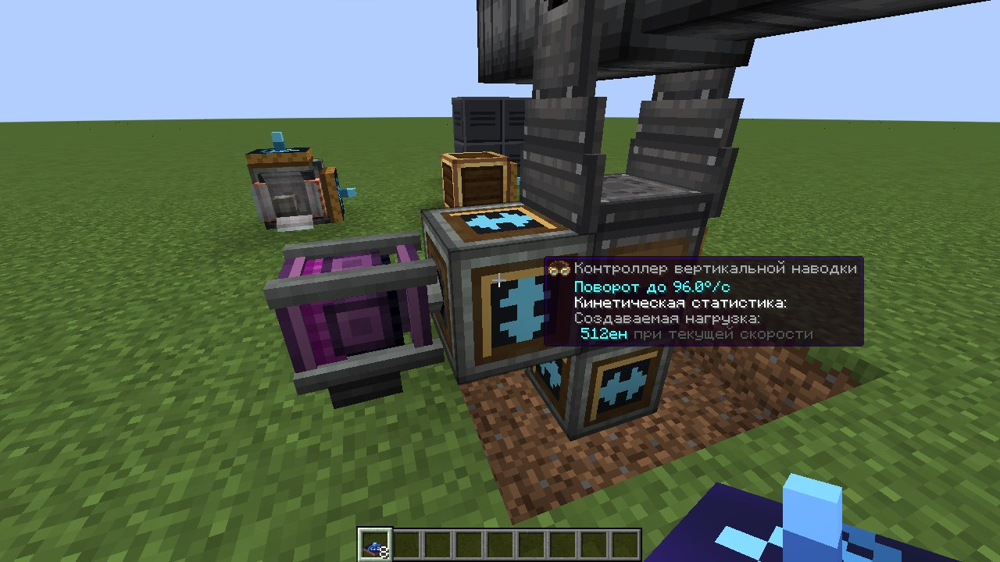
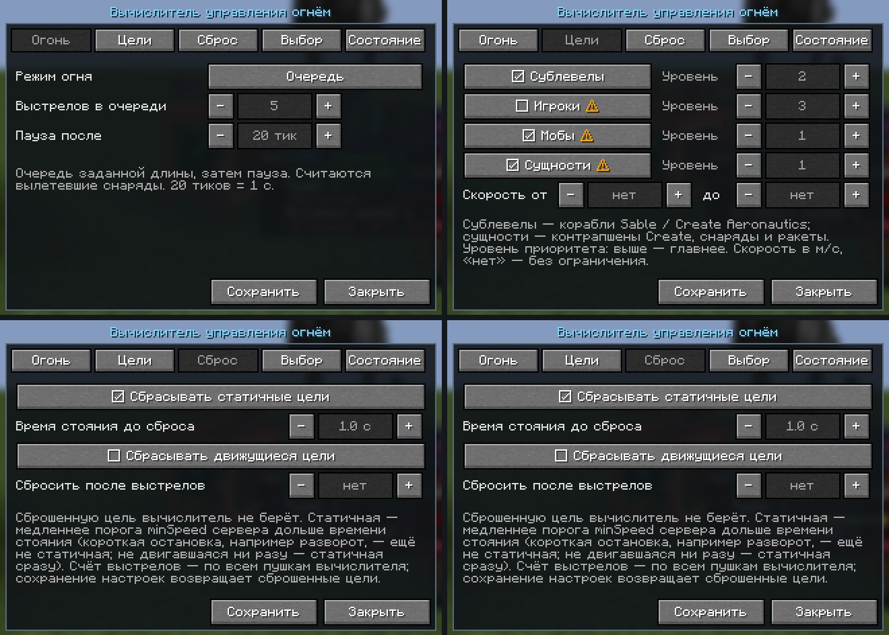
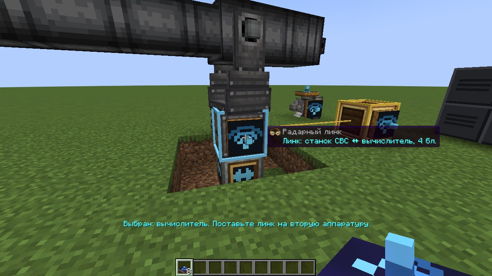

# Create: Radar Fire Control (`radar_fcs`)

Аддон для **Create**, **Create Big Cannons** и **Create: Radars** (NeoForge 1.21.1): вычислитель управления огнём,
контроллеры наводки, радарный линк и радарный монитор. Цели дают радары **Create: Radars**; вычислитель сопровождает
их, решает баллистику с упреждением, поворачивает пушки через контроллеры наводки и стреляет, только когда ствол
действительно наведён и на линии огня нет своих.

Пушки: всё, что ставится на станок CBC, — большие пушки (в том числе со скорострельным затвором и картриджами),
автопушки и пулемёты CBC, **CBC Advanced Technologies** (нарезные стволы, тяжёлые и спаренные автопушки, ракетные
установки), **CBC Neo Warfare** (роторные и средние пушки) и другие аддоны.
Цели: мобы, игроки (по настройке), контрапшены Create и корабли **Create Aeronautics / Sable**.

## Как собрать батарею
1. **Пушка** на станке CBC.
2. **Контроллеры наводки** вплотную к станку: **горизонтальной** — под станком, **вертикальной** — сбоку.
   Вращение подаётся валом в контроллер (горизонтальному — снизу, вертикальному — с противоположной от станка стороны).
3. **Радар Create: Radars** (плоский радар, радарный подшипник и др.) — работающий.
4. **Вычислитель** где угодно и **радарные линки**: вычислитель ↔ станок, вычислитель ↔ радар (и, если нужно,
   вычислитель ↔ монитор, монитор ↔ радар). Автоматического подключения по радиусу нет — только линки.

## Контроллеры наводки


- **Контроллер горизонтальной наводки** (↔) — вплотную под станком CBC (под подвесным — над ним), вал снизу.
- **Контроллер вертикальной наводки** (↕) — вплотную сбоку станка, вал с другой стороны.
- Контроллер поворачивает пушку ровно на нужный угол в нужную сторону по команде вычислителя. Скорость поворота —
  от скорости вала, как у валов CBC: **256 об/мин = 9.6°/тик (192°/с)**, 64 об/мин = 2.4°/тик. Для целей 70 м/с
  подавайте 128–256 об/мин. Нагрузка — 4 ед. стресса на об/мин (`controllerStress`).
- Выходной вал контроллера (к станку) показывает текущий угол пушки, входной крутится вместе с сетью.
- Без контроллера статус пушки «нет контроллера наводки», без вращения — «нет вращения на контроллере наводки»;
  такая пушка не наводится и не стреляет. Очки инженера показывают скорость поворота и нагрузку.

## Радары Create: Radars
Цели берутся **только** с работающих радаров Create: Radars, подключённых радарным линком к вычислителю
(и к монитору, если он есть). Вычислитель уточняет каждую цель по живой сущности каждый тик (корабли — по физике
Sable), поэтому точность огня не зависит от периода обзора радара. Без работающего радара на линке огня нет
(статус «нет радара»).

## Радарный монитор
Ставьте мониторы стеной (до 6x6) — они сложатся в один экран. Картинку дают радары Create: Radars на линках
с любым блоком экрана.
- Круговая развёртка вокруг монитора: **вверх на экране — направление от вас**, когда вы стоите перед монитором.
- Показываются только **активные чужие цели**: свои (транспондер, владелец, команда) и неподвижные скрыты.
  Оранжевые — цели, красные — по ним ведётся огонь, жёлтая рамка — назначенная цель, зелёные — радары.
- **ПКМ по отметке** — назначить цель вычислителям на линках монитора: они бьют по ней в первую очередь.
  ПКМ мимо отметок — снять назначение.
- **Shift+ПКМ** — масштаб (авто, 32…1024 блоков). **Краситель** — канал «свой-чужой» для отбора отметок.


## Вычислитель управления огнём
Подключается **радарными линками** к станкам, радарам и мониторам на расстоянии до 64 блоков (`radarLinkRange`).

- **ПКМ** — экран настроек (у каждого вычислителя свои, сохраняются в блоке). Вкладка «Состояние» — сводка:
  радары, пушки, их состояние, расчётный промах и разброс ствола, активные цели, линки.
  Если разброс пушки большой (жёлтым), удлините ствол или уменьшите заряд — так CBC сужает разброс.
- **Shift+ПКМ** — запретить или разрешить огонь (наведение продолжается).
- **ПКМ красителем** — канал «свой-чужой» (транспондеры).
- **Очки инженера Create** — та же сводка. **Display Link** — источник «Цели СУО». **Компаратор** — число целей.


### Настройки вычислителя (ПКМ)


| Вкладка | Настройка | Варианты |
|---|---|---|
| Огонь | режим огня | **одиночный** (выстрел, пауза), **автоматический** (без пауз), **очередь** (N выстрелов, пауза) |
| | выстрелов в очереди, пауза | 2–100; 0–1200 тиков (20 тиков = 1 с) |
| Цели | типы целей | **сублевелы** (корабли Sable / Create Aeronautics), **игроки**, **мобы**, **сущности** (контрапшены, снаряды, ракеты) |
| | уровень приоритета типа | 1–5, выше — главнее (по умолчанию игроки 3, сублевелы 2, мобы и сущности 1) |
| | скорость от / до | м/с, «нет» — без ограничения |
| Сброс | статичные / движущиеся | не брать стоящие (по умолчанию) или движущиеся цели |
| | время стояния до сброса | 0–60 с (по умолчанию 1 с): цель, которая двигалась, считается статичной, только простояв столько; короткая остановка (разворот) — ещё не статичная. Это же время — для переключения «при остановке» |
| | после N выстрелов | цель больше не берётся (счёт по всем пушкам вычислителя; сохранение настроек сбрасывает список) |
| Выбор | приоритетная цель | ближайшая, наиболее ранняя (дольше всех на радаре), наиболее дальняя, крупнейшая, наименьшая, самая быстрая, самая медленная |
| | переключение по приоритету | перейти на цель выше уровнем (или заметно лучше по режиму), как только она появилась; выключено — держать текущую |
| | переключение между целями | отсутствует, после N выстрелов, через время, при остановке; оставленные цели обходятся по кругу, единственная цель остаётся под огнём |

Порядок выбора: уровень типа цели → режим приоритета; назначенная с монитора цель — вне очереди. Выстрелы считаются
по снарядам, вылетевшим из ствола. Конфиг сервера (`targets.*`) — верхняя граница: тип, запрещённый на сервере,
не берётся, даже если включён в настройках (на экране помечен ⚠).

### Радарный линк


Единственный способ подключить аппаратуру (как Display Link у Create):
1. **ПКМ линком** по первой аппаратуре — она выбрана (голубая рамка, предмет светится).
2. **ПКМ по второй** — на её грань ставится блок линка, связь работает сразу. Рамка под прицелом зелёная — связать
   можно, красная — нельзя. **Shift+ПКМ** — снять выбор.

| Связь | Что даёт |
|---|---|
| вычислитель ↔ станок CBC | вычислитель управляет этой пушкой |
| вычислитель ↔ радар Create: Radars | цели с этого радара |
| вычислитель ↔ монитор | цель, назначенная на мониторе, идёт этому вычислителю; на мониторе видно, по каким целям он ведёт огонь |
| монитор ↔ радар Create: Radars | картинка монитора с этого радара |

Взгляд на линк показывает оба конца и линию между ними, очки инженера — что с чем связано. Сломали аппаратуру — линк
отваливается. Длина до `radarLinkRange` (64 блока). Рецепт: передатчик Create, 2 медных слитка, электронная лампа,
редстоун → 2 линка.

### Транспондер «свой-чужой»
- На земле — защищает всё в радиусе `iffRadius` (база). На корабле Sable — весь корабль свой.
  В контрапшене Create — весь контрапшен свой.
- **ПКМ красителем** — канал: разные команды используют разные цвета.

## Как работает
1. **Обнаружение.** Радары Create: Radars на линках дают отметки, вычислитель сопровождает цели по живой сущности
   каждый тик (корабли — по физике Sable, прицел в центр масс). Без работающего радара огня нет.
2. **Треки.** Скорость и ускорение — взвешенный МНК по окну замеров. При резком манёвре (большая невязка)
   окно укорачивается, и по цели не стреляют, пока оценка не устоится (обычно 5–6 тиков после разворота).
   Неподвижные и медленные цели (`minSpeed`) по умолчанию неактивны (настройка «сбрасывать статичные»).
3. **Приоритет.** Назначенная с монитора цель, иначе по настройкам вычислителя (по умолчанию ближайшая к каждой пушке;
   текущую держим, пока новая не станет заметно лучше).
4. **Баллистика.** Модель полёта повторяет CBC: гравитация, сопротивление, скорость по зарядам или стволам,
   смещение дульного среза, разброс ствола. С **CBC Advanced Technologies** скорость и разброс большой пушки считаются
   по его физике выстрела (газ зарядов и сопротивление стволов) — первый выстрел тоже точный.
   Упреждение ищется методом секущих — сходится и для целей, чья скорость сравнима со скоростью снаряда.
5. **Потиковый перехват.** Minecraft проверяет попадание раз в тик: отрезок полёта снаряда за тик против цели на конец тика.
   Поэтому вычислитель целится в положение цели на конец того тика, в котором снаряд проходит эту точку.
   Для мелких быстрых целей (цель за тик пролетает больше своего размера) это и есть разница между попаданием и промахом.
6. **Момент выстрела.** CBC берёт направление выстрела не из текущего положения ствола: большая пушка стреляет сразу,
   по положению на начало тика, автопушка — в следующем тике. Вычислитель ведёт ствол с опережением на этот тик и
   стреляет, когда снаряд из **фактического** положения ствола заденет цель. Как и в CBC, проверяется отрезок полёта
   против габарита цели, расширенного на размер снаряда: у мобов и игроков — точный габарит (высокую цель можно бить
   выше или ниже центра), у кораблей и контрапшенов — по центру с допуском. Встреча «впритирку» к границе тика не
   засчитывается: доля блока по траектории перенесла бы её на соседний тик. У автопушек промах считается для каждого
   следующего выстрела очереди, запас — по разбросу ствола. Линия огня проверяется заново, как только точка встречи
   сместилась (быстрая цель за край стены — огня нет).
7. **Обучение по выстрелам.** Вычислитель следит за снарядом и уточняет скорость, вынос дульного среза и модель полёта
   (ракеты CBC-AT, в том числе с медленным стартом и разгоном из исправления CBC-AT, снаряды аддонов).
   Снаряд, пробивший цель, резко тормозит — этот участок в модель не записывается.

### Быстрые цели (игровые тесты)
| Цель | Пушка | Снаряды в цель |
|---|---|---|
| 70 м/с поперёк линии огня, 40 блоков | автопушка, 4 ствола | 97 % (85 % с учётом снарядов, летевших в момент разворота цели) |
| 100 м/с поперёк линии огня | автопушка, 4 ствола | 100 % (78–87 %) |
| 70 м/с, пикирует со сближением | автопушка | 100 % (82–86 %) |
| корабль Sable 3x3x3, 70 м/с | три большие пушки, по выстрелу | 3 из 3 без CBC-AT; 1–3 из 3 с CBC-AT (его разброс ±1.9° у тестовой пушки) |

Пушки из реальной сборки (CBC 5.11.7, CBC-AT 0.1.4c + исправление CBC-AT 1.1.4, CBC Neo Warfare 0.0.6v)
по той же цели 70 м/с; средняя и большая пушки перезаряжаются тестом (как автоматом заряжания). Пока пушка пуста,
вычислитель проверяет заряжание каждые 2 тика: средняя пушка с автоматом на 5 тиков стреляет раз в 10 тиков (было 21):

| Пушка | Расчёт вылета против факта | Снаряды в цель |
|---|---|---|
| стальная автопушка, 3 ствола, бронебойные патроны | 0.00° и 0.00 блока, скорость точно | 97–100 % (81–83 %) |
| бронзовая роторная пушка Neo Warfare, 3 ствола | 0.00° и 0.00 блока, скорость точно | 94–96 % (77–78 %) |
| незерстальная средняя пушка Neo Warfare, 3 ствола | 0.00° и 0.00 блока, скорость точно | 100 % (73 %) |
| стальная большая: скорострельный затвор, ствол + 4 нарезных CBC-AT, картридж 4/4 | скорость 7.60 точно, отклонение 0.01–0.3° (разброс CBC-AT) | 100 % (79–92 %) |

Первая цифра — снаряды, выпущенные не в момент разворота цели, в скобках — все. Цель в тестах разворачивается на 180°
мгновенно: снаряды, которые в этот момент уже летят, промахиваются при любом расчёте (настоящая цель так не умеет).
Расчётный путь снаряда совпадает с фактическим до сотых блока. Осколки бронебойных снарядов выстрелами не считаются.


## Чем отличается от наведения самого Create: Radars
- Наведение с упреждением по скорости и ускорению цели, потиковый перехват, обучение баллистики по выстрелам —
  попадания по целям 70–100 м/с (см. таблицы выше).
- Цель уточняется по живой сущности каждый тик, а не по отметке радара; свои и неподвижные цели на мониторе не показываются.
- Огонь — только когда снаряд из фактического положения ствола заденет цель и на траектории нет своих.
- Настройки режимов огня, типов целей, сброса, приоритета и переключения у каждого вычислителя.

## Настройка
Серверный конфиг: `world/serverconfig/radar_fcs-server.toml`. Основное:

| Параметр | По умолчанию | Смысл |
|---|---|---|
| `links.radarLinkRange` | 64 | наибольшая длина радарного линка, блоков |
| `monitor.designationTicks` | 1200 | сколько держится назначение цели с монитора, тиков |
| `sensor.minSpeed` | 0.6 | цели медленнее (блоков/с) неактивны |
| `targets.*` | мобы, корабли, контрапшены | кого атаковать; игроки выключены |
| `iff.iffRadius` | 12 | радиус защиты наземного транспондера |
| `aiming.requireRotation` | true | станок поворачивают контроллеры наводки, скорость — от их валов (как у валов CBC) |
| `aiming.shaftSpeedMultiplier` | 1.0 | множитель скорости поворота от контроллеров |
| `aiming.controllerStress` | 4 | нагрузка контроллера наводки, ед. стресса на об/мин |
| `aiming.slewDegPerTick` | 6 | скорость поворота без контроллеров и кинетики (`requireRotation = false`) |
| `aiming.fireToleranceDeg` | 0.2 | допуск выстрела по кораблям и контрапшенам (по мобам — точный габарит) |
| `aiming.rapidFireMarginBlocks` | 0.1 | запас промаха очереди автопушки сверх разброса ствола |
| `aiming.discreteIntercept` | true | потиковое упреждение (для быстрых мелких целей) |
| `aiming.fireMinTrackTicks` | 6 | не стрелять по цели, которую сопровождаем меньше стольких тиков |
| `sensor.scanIntervalTicks` | 1 | период замеров целей |
| `firing.learnFromShots` | true | уточнять баллистику по выстрелам |

## Совместимость
- Обязательно: Create 6.0.x, Create Big Cannons 5.10+, **Create: Radars 0.4.9.x или 5.x** (радары). Sable companion (MIT) встроен в jar.
- Не ставьте на те же станки auto yaw/pitch контроллеры Create: Radars — вычислитель уступает такие станки.
- Create Aeronautics / Sable — по желанию (корабли как цели, транспондер на кораблях).
- **С версии 0.7 своих радаров нет** (радарный подшипник, решётка, купол удалены — в мирах они исчезнут), автоподключения
  по радиусу нет: подключите пушки, радары и мониторы радарными линками и поставьте контроллеры наводки к станкам.
- **CBC Advanced Technologies 0.1.4c без исправлений не работает с CBC 5.11.4 и новее** (`NoSuchMethodError ... onRecoil`
  при выстреле). Используйте CBC 5.11.3 или **CBC: Advanced technologies crash fix** (`cbcatfix`, проверено 1.1.4 на CBC 5.11.7):
  с ним ракеты стартуют медленно и разгоняются двигателем (вычислитель выучивает разгон за 1–2 выстрела),
  пусковая — не длиннее 3 блоков вместе с казёнником, ракете нужно топливо (собранная на верстаке его имеет).
- **CBC Neo Warfare** (порт CBC Modern Warfare, проверено 0.0.6v): роторная пушка ведётся как автопушка,
  средняя — как большая (выстрел по фронту сигнала); скорость и разброс — по материалу и числу стволов, точка вылета —
  как у самой пушки. Средней пушке нужен автомат заряжания: без патрона в казённике статус «нет боеприпасов».
- **CBC Advanced Technologies**: его переработанная физика выстрела больших пушек учитывается (скорость и разброс);
  если в его конфиге `disablePhysicRework = true`, считается по формулам CBC.
- После обновления с версий до 0.4 ключи наведения в конфиге новые (`requireRotation`, `fireToleranceDeg`,
  `rapidFireMarginBlocks`, `scanIntervalTicks`, `extraLatencyTicks`): старые значения не переносятся.

## Сборка
```bash
./gradlew build              # jar в build/libs/
./gradlew coreTest           # офлайн-тест баллистики и треков
./gradlew runGameTestServer  # 30 игровых тестов (моды скачиваются в run/mods)
./gradlew runGameTestServer -PfcsMinimal   # то же только с обязательными Create, CBC и Create Radars
./gradlew runGameTestServer -PfcsNoCbcAt   # без CBC Advanced Technologies
./gradlew runGameTestServer -PfcsProbe     # с подробным разбором каждого выстрела в логе
./gradlew runGameTestServer -PfcsExtraMods=<папка>   # плюс jar'ы из папки (CurseForge: cbcatfix, CBC Neo Warfare)
```
