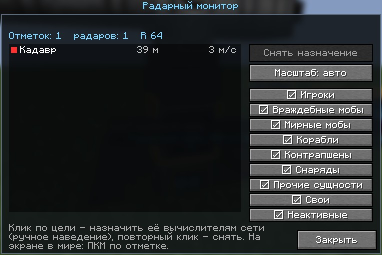
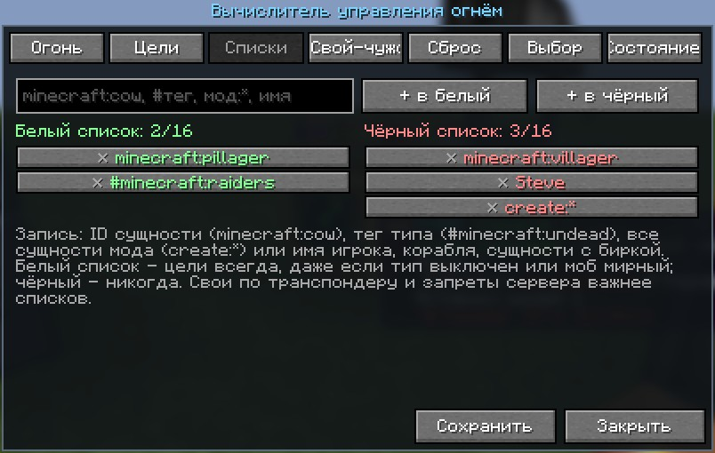
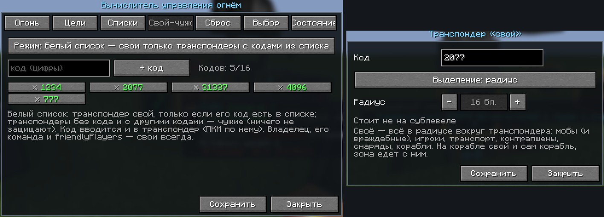

# Create: Radar Fire Control (`radar_fcs`)

Аддон для **Create**, **Create Big Cannons** и **Create: Radars** (NeoForge 1.21.1): вычислитель управления огнём,
контроллеры наводки, радарный линк и радарный монитор. Цели дают радары **Create: Radars**; вычислитель сопровождает
их, решает баллистику с упреждением, поворачивает пушки через контроллеры наводки и стреляет, только когда ствол
действительно наведён и на линии огня нет своих.

Пушки: всё, что ставится на станок CBC, — большие пушки (в том числе со скорострельным затвором и картриджами),
автопушки и пулемёты CBC, **CBC Advanced Technologies** (нарезные стволы, тяжёлые и спаренные автопушки, ракетные
установки), **CBC Neo Warfare** (роторные и средние пушки) и другие аддоны.
Цели: мобы (враждебные; мирные — через белый список), игроки, контрапшены Create, снаряды и ракеты, лодки, вагонетки
и прочие сущности, корабли **Create Aeronautics / Sable**. Белый и чёрный списки целей у каждого вычислителя,
ручное наведение с монитора (своего или Create: Radars).

## Как собрать батарею
1. **Пушка** на станке CBC.
2. **Контроллеры наводки** вплотную к станку: **горизонтальной** — под станком, **вертикальной** — сбоку.
   Вращение подаётся валом в контроллер (горизонтальному — снизу, вертикальному — с противоположной от станка стороны).
3. **Радар Create: Radars** (плоский радар, радарный подшипник и др.) — работающий.
4. **Вычислитель** где угодно и **радарные линки** на вычислитель, станки, радар (и, если нужно, монитор) — все в одной
   **радарной сети**, как складские передатчики Create. Автоматического подключения по радиусу нет — только линки.
5. **Электричество (FE)** — вычислителю 1024 FE/т, монитору, транспондеру и блокам памяти — свои нормы
   (см. «Электропитание»): генераторы Create Crafts & Additions или любой мод с FE.

## Контроллеры наводки


- **Контроллер горизонтальной наводки** (↔) — вплотную под станком CBC (под подвесным — над ним), вал снизу.
- **Контроллер вертикальной наводки** (↕) — вплотную сбоку станка, вал с другой стороны.
- Контроллер поворачивает пушку ровно на нужный угол в нужную сторону по команде вычислителя. Скорость поворота —
  от скорости вала, как у валов CBC: **256 об/мин = 9.6°/тик (192°/с)**, 64 об/мин = 2.4°/тик. Для целей 70 м/с
  подавайте 128–256 об/мин. Нагрузка — 4 ед. стресса на об/мин (`controllerStress`).
- Выходной вал контроллера (к станку) показывает текущий угол пушки, входной крутится вместе с сетью.
- Без контроллера статус пушки «нет контроллера наводки», без вращения — «нет вращения на контроллере наводки»;
  такая пушка не наводится и не стреляет. Очки инженера показывают скорость поворота и нагрузку.

## Радары Create: Radars
Цели берутся с работающих радаров Create: Radars в радарной сети вычислителя (и монитора, если он есть).
Вычислитель уточняет каждую цель по живой сущности каждый тик (корабли — по физике Sable), поэтому точность огня
не зависит от периода обзора радара. Без работающего радара в сети огня нет (статус «нет радара») — кроме цели,
назначенной вручную на мониторе: её вычислитель ведёт сам.

## Радарный монитор
Ставьте мониторы стеной (до 6x6) — они сложатся в один экран. Картинку дают радары Create: Radars радарной сети
монитора (линк — на любом блоке экрана).
- Круговая развёртка вокруг монитора: **вверх на экране — направление от вас**, когда вы стоите перед монитором.
- Показываются **все цели** радаров: оранжевые — угрозы (враждебные мобы, игроки, корабли, контрапшены, снаряды),
  голубые — мирные мобы и прочие сущности, зелёные — свои (транспондер, владелец, команда), серые — неактивные
  (стоят на месте), красные — по ним ведётся огонь, жёлтая рамка — назначенная цель, зелёные квадраты — радары.
- **Взгляд на экран** — курсор; отметка под ним в белой рамке, вверху экрана — имя, состояние, координаты,
  дальность, высота и скорость цели (так же для назначенной цели).
- **ПКМ по отметке** — ручное наведение: назначить цель вычислителям сети монитора, они бьют по ней в первую очередь,
  в обход типов целей, списков и окна скорости (но не по своим и не в обход запретов сервера). ПКМ мимо отметок —
  снять назначение. Назначение держится, пока его не снимут или цель не пропадёт (`designationTicks`).
- **Shift+ПКМ** — окно монитора: список целей (клик — назначить или снять), фильтры показа (игроки, враждебные,
  мирные, корабли, контрапшены, снаряды, прочие, свои, неактивные), масштаб (авто, 32…1024 блоков).
- Свои и чужие на экране — по правилу «свой-чужой» (коды транспондеров) первого вычислителя сети монитора.

**Монитор Create: Radars** тоже можно поставить в сеть линком: цель, выбранная на нём игроком, — ручное
наведение для вычислителей сети (так же, как на своём мониторе).




## Вычислитель управления огнём
Подключается **радарной сетью** (радарные линки) к станкам, радарам и мониторам — на любом расстоянии.

- **ПКМ** — экран настроек (у каждого вычислителя свои, сохраняются в блоке). Вкладка «Состояние» — сводка:
  радары, пушки, их состояние, расчётный промах и разброс ствола, активные цели, линки — и кнопки
  **«Собрать пушки»** / **«Разобрать пушки»** (все пушки вычислителя сразу; разобранные он не собирает, пока не нажата
  «Собрать», — удобно для перезарядки и перестройки).
  Если разброс пушки большой (жёлтым), удлините ствол или уменьшите заряд — так CBC сужает разброс.
- **Shift+ПКМ** — запретить или разрешить огонь (наведение продолжается).
- **Очки инженера Create** — та же сводка. **Display Link** — источник «Цели СУО». **Компаратор** — число целей.


### Настройки вычислителя (ПКМ)


| Вкладка | Настройка | Варианты |
|---|---|---|
| Огонь | режим огня | **одиночный** (выстрел, пауза), **автоматический** (без пауз), **очередь** (N выстрелов, пауза) |
| | выстрелов в очереди, пауза | 2–100; 0–1200 тиков (20 тиков = 1 с) |
| Цели | типы целей | **сублевелы** (корабли Sable / Create Aeronautics), **игроки** (по умолчанию выключены), **мобы**, **сущности** (контрапшены, снаряды, ракеты, лодки, вагонетки и прочие) |
| | уровень приоритета типа | 1–5, выше — главнее (по умолчанию игроки 3, сублевелы 2, мобы и сущности 1) |
| | скорость от / до | м/с, «нет» — без ограничения |
| | мобы: только враждебные | включено по умолчанию: мирные мобы — только через белый список |
| Списки | белый список | цели всегда, даже если их тип выключен или моб мирный |
| | чёрный список | никогда не цели |
| Свой-чужой | режим | **белый список кодов** (свои — только транспондеры с кодами из списка) или **чёрный список кодов** (свои — все транспондеры, кроме кодов из списка; по умолчанию, пустой) |
| | коды | коды по 1–8 цифр; видят и меняют только владелец вычислителя, его команда и операторы |

В каждом списке (белый, чёрный, коды) — **16 записей**, и ещё **+16 за каждый блок памяти** с питанием в радарной сети
вычислителя. Записи сверх памяти хранятся, но не действуют (серые на экране). Длинные списки прокручиваются колесом мыши.
| Сброс | статичные / движущиеся | не брать стоящие (по умолчанию) или движущиеся цели |
| | время стояния до сброса | 0–60 с (по умолчанию 1 с): цель, которая двигалась, считается статичной, только простояв столько; короткая остановка (разворот) — ещё не статичная. Это же время — для переключения «при остановке» |
| | после N выстрелов | цель больше не берётся (счёт по всем пушкам вычислителя; сохранение настроек сбрасывает список) |
| Выбор | приоритетная цель | ближайшая, наиболее ранняя (дольше всех на радаре), наиболее дальняя, крупнейшая, наименьшая, самая быстрая, самая медленная |
| | переключение по приоритету | перейти на цель выше уровнем (или заметно лучше по режиму), как только она появилась; выключено — держать текущую |
| | переключение между целями | отсутствует, после N выстрелов, через время, при остановке; оставленные цели обходятся по кругу, единственная цель остаётся под огнём |

Запись списка: ID сущности (`minecraft:cow`), тег типа (`#minecraft:undead`), все сущности мода (`create:*`) или имя
(игрока, корабля, сущности с биркой); регистр не важен. Свои по транспондеру и запреты сервера важнее списков.



Порядок выбора: уровень типа цели → режим приоритета; назначенная с монитора цель — вне очереди. Выстрелы считаются
по снарядам, вылетевшим из ствола. Конфиг сервера (`targets.*`) — верхняя граница: тип, запрещённый на сервере,
не берётся, даже если включён в настройках (на экране помечен ⚠).

### Радарный линк


Единственный способ подключить аппаратуру. Работает как **складской передатчик Create**: каждый линк — участник
**радарной сети**, вся аппаратура с линками одной сети связана со всей, расстояние не ограничено (в пределах измерения).
1. **Поставьте линк** на вычислитель, станок, радар Create: Radars, свой монитор или монитор Create: Radars.
   Ненастроенный линк начинает **новую сеть** (в чате — её имя, например «#3F2A»).
2. **ПКМ линком по стоящему линку** — предмет настроен на его сеть (светится). Следующие линки встают в эту сеть.
3. **Shift+ПКМ в воздух** или **сетка крафта** — сбросить настройку предмета.

Что даёт сеть: вычислитель управляет всеми станками сети, берёт цели со всех её радаров и назначения с её мониторов;
монитор рисует цели радаров сети и показывает, по каким целям стреляют её вычислители. Аппаратура может стоять
в нескольких сетях (несколько линков на разных гранях).

Взгляд на линк подсвечивает всю аппаратуру его сети, настроенный линк в руке — тоже (зелёная рамка — сюда можно
поставить линк). Очки инженера и ПКМ по линку — имя сети и сколько в ней вычислителей, пушек, радаров и мониторов.
**Полный сигнал редстоуна** (15) отключает линк. Сломали аппаратуру — линк отваливается. Рецепт: передатчик Create,
2 медных слитка, электронная лампа, редстоун → 2 линка. Парные линки версий 0.6–0.7 продолжают работать.

### Свой-чужой: транспондеры и коды


**Транспондер** (ПКМ — его экран):
- **Код** — комбинация цифр (1–8, можно без кода). По коду вычислитель решает, свой это транспондер или чужой.
- **Режим выделения** — что своё. Внутри зоны своё **всё**: мобы (и враждебные), игроки, транспорт, контрапшены,
  снаряды, корабли:
  - **сублевел, на котором стоит** — корабль Sable / Create Aeronautics (или контрапшен Create) с транспондером и всё
    в его пределах (границы корабля + 2 блока: палуба, борта); не на корабле транспондер в этом режиме ничего не
    защищает (экран предупредит);
  - **радиус** — шар заданного радиуса вокруг транспондера (1–`maxTransponderRadius`, по умолчанию `iffRadius` = 12);
    на корабле зона едет вместе с ним, и сам корабль тоже свой;
  - **сублевел и расстояние от него** — корабль и всё на заданном расстоянии от его границ (охранение, десант рядом
    с бортом); не на корабле — как радиус.
- Режим по умолчанию — по месту: на корабле «сублевел», на земле «радиус». Через свою зону по цели снаружи
  вычислитель не стреляет.
- Входящие снаряды и ракеты внутри зоны тоже считаются своими и не сбиваются — для противоракетной обороны держите
  радиус базы небольшим.
- **Питание**: 64 FE/т; без энергии транспондер ничего не защищает. Транспондер в движущемся контрапшене Create питания
  не требует (блок контрапшена его получить не может).
- Настройки видят и меняют только **владелец** (кто поставил), его команда и операторы — чужой не подсмотрит код.
- Краситель меняет только цвет.

**Вкладка «Свой-чужой» вычислителя** — правило для кодов (16 кодов, +16 за каждый блок памяти):
- **белый список** — свои только транспондеры с кодами из списка; транспондеры без кода и с другими кодами — чужие
  (их корабли и зоны не защищены);
- **чёрный список** — свои все транспондеры (и без кода), кроме кодов из списка.

Пример: у своих транспондеров код 2077, у вычислителя белый список «2077» — корабль противника с транспондером без кода
или с другим кодом остаётся целью. Монитор показывает своих по правилу первого вычислителя своей сети.
Независимо от кодов свои — владелец вычислителя, его команда, `friendlyPlayers`, корабли-носители батареи;
лодка или вагонетка со своим игроком внутри — своя.

### Блок памяти
Ставится в радарную сеть вычислителя (линком) и добавляет каждому его списку 16 записей. Нужно питание 240 FE/т;
без энергии не работает (огни на панели гаснут). Рецепт: латунный корпус, 4 электронные лампы, 2 компаратора,
2 редстоуна (лампы по углам, компараторы сверху и снизу, редстоун по бокам корпуса).

### Электропитание
Блоки мода работают от электричества **FE** (Forge Energy): генератор (alternator) и аккумуляторы
**Create Crafts & Additions**, провода и любые другие моды с FE. Энергию принимает любая грань блока, запас — 2 секунды
работы. Устройства других модов (станки CBC, радары Create Radars) питания не требуют, контроллеры наводки работают
от вращения.

| Блок | Потребление | Без энергии |
|---|---|---|
| Вычислитель | 1024 FE/т | не видит целей, пушки не наводятся и не стреляют (статус «нет энергии») |
| Блок памяти | 240 FE/т | не добавляет записей к спискам |
| Транспондер | 64 FE/т | не защищает |
| Радарный монитор | 32 FE/т за блок экрана | экран погашен; энергию можно подать в любой блок стены |

Генератор Crafts & Additions на 256 об/мин даёт около 360 FE/т — вычислителю нужно 3 генератора или аккумулятор.
Значения настраиваются в конфиге сервера (`energy.*`), `energy.requirePower = false` отключает требование.

## Как работает
1. **Обнаружение.** Радары Create: Radars на линках дают отметки, вычислитель сопровождает цели по живой сущности
   каждый тик (корабли — по физике Sable, прицел в центр масс). Без работающего радара огня нет.
2. **Треки.** Скорость и ускорение — взвешенный МНК по окну замеров. При резком манёвре (большая невязка)
   окно укорачивается, и по цели не стреляют, пока оценка не устоится (обычно 5–6 тиков после разворота).
   Неподвижные и медленные цели (`minSpeed`) по умолчанию неактивны (настройка «сбрасывать статичные»).
3. **Приоритет.** Назначенная с монитора цель, иначе по настройкам вычислителя (по умолчанию ближайшая к каждой пушке;
   текущую держим, пока новая не станет заметно лучше).
4. **Баллистика.** Модель полёта повторяет CBC: гравитация, сопротивление, скорость по зарядам или стволам,
   смещение дульного среза, разброс ствола. С **CBC Advanced Technologies** скорость и разброс большой пушки считаются
   по его физике выстрела (газ зарядов и сопротивление стволов) — первый выстрел тоже точный.
   Упреждение ищется методом секущих — сходится и для целей, чья скорость сравнима со скоростью снаряда.
5. **Потиковый перехват.** Minecraft проверяет попадание раз в тик: отрезок полёта снаряда за тик против цели на конец тика.
   Поэтому вычислитель целится в положение цели на конец того тика, в котором снаряд проходит эту точку.
   Для мелких быстрых целей (цель за тик пролетает больше своего размера) это и есть разница между попаданием и промахом.
6. **Момент выстрела.** CBC берёт направление выстрела не из текущего положения ствола: большая пушка стреляет сразу,
   по положению на начало тика, автопушка — в следующем тике. Вычислитель ведёт ствол с опережением на этот тик и
   стреляет, когда снаряд из **фактического** положения ствола заденет цель. Как и в CBC, проверяется отрезок полёта
   против габарита цели, расширенного на размер снаряда: у мобов и игроков — точный габарит (высокую цель можно бить
   выше или ниже центра), у кораблей и контрапшенов — по центру с допуском. Встреча «впритирку» к границе тика не
   засчитывается: доля блока по траектории перенесла бы её на соседний тик. У автопушек промах считается для каждого
   следующего выстрела очереди, запас — по разбросу ствола. Линия огня проверяется заново, как только точка встречи
   сместилась (быстрая цель за край стены — огня нет).
7. **Обучение по выстрелам.** Вычислитель следит за снарядом и уточняет скорость, вынос дульного среза и модель полёта
   (ракеты CBC-AT, в том числе с медленным стартом и разгоном из исправления CBC-AT, снаряды аддонов).
   Снаряд, пробивший цель, резко тормозит — этот участок в модель не записывается.

### Быстрые цели (игровые тесты)
| Цель | Пушка | Снаряды в цель |
|---|---|---|
| 70 м/с поперёк линии огня, 40 блоков | автопушка, 4 ствола | 97 % (85 % с учётом снарядов, летевших в момент разворота цели) |
| 100 м/с поперёк линии огня | автопушка, 4 ствола | 100 % (78–87 %) |
| 70 м/с, пикирует со сближением | автопушка | 100 % (82–86 %) |
| корабль Sable 3x3x3, 70 м/с | три большие пушки, по выстрелу | 3 из 3 без CBC-AT; 1–3 из 3 с CBC-AT (его разброс ±1.9° у тестовой пушки) |

Пушки из реальной сборки (CBC 5.11.7, CBC-AT 0.1.4c + исправление CBC-AT 1.1.4, CBC Neo Warfare 0.0.6v)
по той же цели 70 м/с; средняя и большая пушки перезаряжаются тестом (как автоматом заряжания). Пока пушка пуста,
вычислитель проверяет заряжание каждые 2 тика: средняя пушка с автоматом на 5 тиков стреляет раз в 10 тиков (было 21):

| Пушка | Расчёт вылета против факта | Снаряды в цель |
|---|---|---|
| стальная автопушка, 3 ствола, бронебойные патроны | 0.00° и 0.00 блока, скорость точно | 97–100 % (81–83 %) |
| бронзовая роторная пушка Neo Warfare, 3 ствола | 0.00° и 0.00 блока, скорость точно | 94–96 % (77–78 %) |
| незерстальная средняя пушка Neo Warfare, 3 ствола | 0.00° и 0.00 блока, скорость точно | 100 % (73 %) |
| стальная большая: скорострельный затвор, ствол + 4 нарезных CBC-AT, картридж 4/4 | скорость 7.60 точно, отклонение 0.01–0.3° (разброс CBC-AT) | 100 % (79–92 %) |

Первая цифра — снаряды, выпущенные не в момент разворота цели, в скобках — все. Цель в тестах разворачивается на 180°
мгновенно: снаряды, которые в этот момент уже летят, промахиваются при любом расчёте (настоящая цель так не умеет).
Расчётный путь снаряда совпадает с фактическим до сотых блока. Осколки бронебойных снарядов выстрелами не считаются.


## Чем отличается от наведения самого Create: Radars
- Наведение с упреждением по скорости и ускорению цели, потиковый перехват, обучение баллистики по выстрелам —
  попадания по целям 70–100 м/с (см. таблицы выше).
- Цель уточняется по живой сущности каждый тик, а не по отметке радара; ручное наведение работает и без радара.
- Огонь — только когда снаряд из фактического положения ствола заденет цель и на траектории нет своих.
- Настройки режимов огня, типов целей, сброса, приоритета и переключения у каждого вычислителя.

## Настройка
Серверный конфиг: `world/serverconfig/radar_fcs-server.toml`. Основное:

| Параметр | По умолчанию | Смысл |
|---|---|---|
| `monitor.designationTicks` | 0 | сколько держится назначение цели с монитора, тиков; 0 — пока его не снимут или цель не пропадёт |
| `sensor.minSpeed` | 0.6 | цели медленнее (блоков/с) неактивны |
| `targets.allow*` | всё разрешено | верхняя граница для настроек вычислителей: `allowMobs`, `allowPlayers`, `allowShips`, `allowContraptions`, `allowProjectiles`, `allowOtherEntities` |
| `iff.iffRadius` | 12 | радиус нового транспондера (режим «радиус») |
| `iff.maxTransponderRadius` | 64 | наибольший радиус, который можно задать транспондеру |
| `energy.requirePower` | true | блокам мода нужно электричество (FE) |
| `energy.fireControlUsage` / `memoryUsage` / `transponderUsage` / `monitorUsage` | 1024 / 240 / 64 / 32 | потребление, FE/т (монитор — за блок экрана) |
| `aiming.requireRotation` | true | станок поворачивают контроллеры наводки, скорость — от их валов (как у валов CBC) |
| `aiming.shaftSpeedMultiplier` | 1.0 | множитель скорости поворота от контроллеров |
| `aiming.controllerStress` | 4 | нагрузка контроллера наводки, ед. стресса на об/мин |
| `aiming.slewDegPerTick` | 6 | скорость поворота без контроллеров и кинетики (`requireRotation = false`) |
| `aiming.fireToleranceDeg` | 0.2 | допуск выстрела по кораблям и контрапшенам (по мобам — точный габарит) |
| `aiming.rapidFireMarginBlocks` | 0.1 | запас промаха очереди автопушки сверх разброса ствола |
| `aiming.discreteIntercept` | true | потиковое упреждение (для быстрых мелких целей) |
| `aiming.fireMinTrackTicks` | 6 | не стрелять по цели, которую сопровождаем меньше стольких тиков |
| `sensor.scanIntervalTicks` | 1 | период замеров целей |
| `firing.learnFromShots` | true | уточнять баллистику по выстрелам |

## Совместимость
- Обязательно: Create 6.0.x, Create Big Cannons 5.10+, **Create: Radars 0.4.9.x или 5.x** (радары). Sable companion (MIT) встроен в jar.
- Не ставьте на те же станки auto yaw/pitch контроллеры Create: Radars — вычислитель уступает такие станки.
- Create Aeronautics / Sable — по желанию (корабли как цели, транспондер на кораблях).
- Электричество — любой мод с FE; проверено с **Create Crafts & Additions** 1.6.0 (свежие 1.7.x требуют NeoForge 21.1.248+).
- **С версии 0.10** блоки мода требуют электричество (FE), зона транспондера бережёт всё внутри (и врагов), списки —
  16 записей + 16 за блок памяти (было 10 и 16).
- **С версии 0.9** «свой-чужой» — по кодам транспондеров и вкладке «Свой-чужой» вычислителя; каналы-красители
  вычислителей, мониторов и транспондеров больше не действуют (по умолчанию — чёрный список без кодов: свои все
  транспондеры). Если команды на сервере различались цветами, задайте транспондерам коды, а вычислителям — списки.
- **С версии 0.8** линки — сети, как у складских передатчиков (старые парные линки работают), ключи `targets.*`
  в конфиге сервера новые (`allow*`, всё разрешено; старые `target*` не переносятся), зона наземного транспондера
  больше не прикрывает врагов.
- **С версии 0.7 своих радаров нет** (радарный подшипник, решётка, купол удалены — в мирах они исчезнут), автоподключения
  по радиусу нет: подключите пушки, радары и мониторы радарными линками и поставьте контроллеры наводки к станкам.
- **CBC Advanced Technologies 0.1.4c без исправлений не работает с CBC 5.11.4 и новее** (`NoSuchMethodError ... onRecoil`
  при выстреле). Используйте CBC 5.11.3 или **CBC: Advanced technologies crash fix** (`cbcatfix`, проверено 1.1.4 на CBC 5.11.7):
  с ним ракеты стартуют медленно и разгоняются двигателем (вычислитель выучивает разгон за 1–2 выстрела),
  пусковая — не длиннее 3 блоков вместе с казёнником, ракете нужно топливо (собранная на верстаке его имеет).
- **CBC Neo Warfare** (порт CBC Modern Warfare, проверено 0.0.6v): роторная пушка ведётся как автопушка,
  средняя — как большая (выстрел по фронту сигнала); скорость и разброс — по материалу и числу стволов, точка вылета —
  как у самой пушки. Средней пушке нужен автомат заряжания: без патрона в казённике статус «нет боеприпасов».
- **CBC Advanced Technologies**: его переработанная физика выстрела больших пушек учитывается (скорость и разброс);
  если в его конфиге `disablePhysicRework = true`, считается по формулам CBC.
- После обновления с версий до 0.4 ключи наведения в конфиге новые (`requireRotation`, `fireToleranceDeg`,
  `rapidFireMarginBlocks`, `scanIntervalTicks`, `extraLatencyTicks`): старые значения не переносятся.

## Сборка
```bash
./gradlew build              # jar в build/libs/
./gradlew coreTest           # офлайн-тест баллистики и треков
./gradlew runGameTestServer  # 53 игровых теста (моды скачиваются в run/mods)
./gradlew runGameTestServer -PfcsMinimal   # то же только с обязательными Create, CBC и Create Radars
./gradlew runGameTestServer -PfcsNoCbcAt   # без CBC Advanced Technologies
./gradlew runGameTestServer -PfcsProbe     # с подробным разбором каждого выстрела в логе
./gradlew runGameTestServer -PfcsExtraMods=<папка>   # плюс jar'ы из папки (CurseForge: cbcatfix, CBC Neo Warfare)
```
